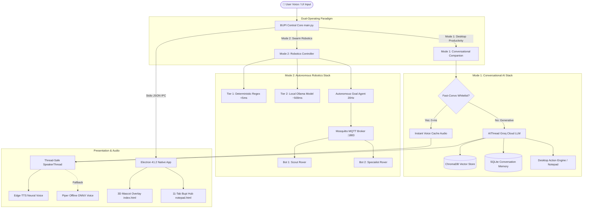
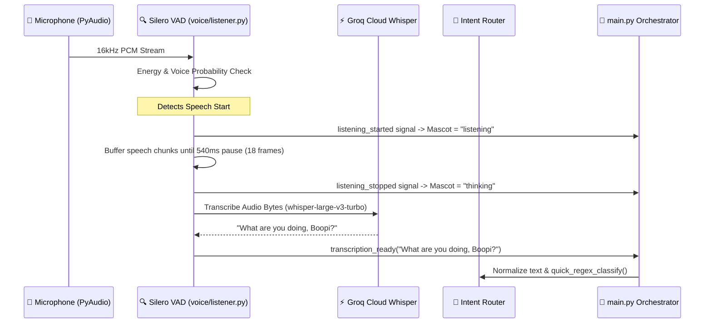
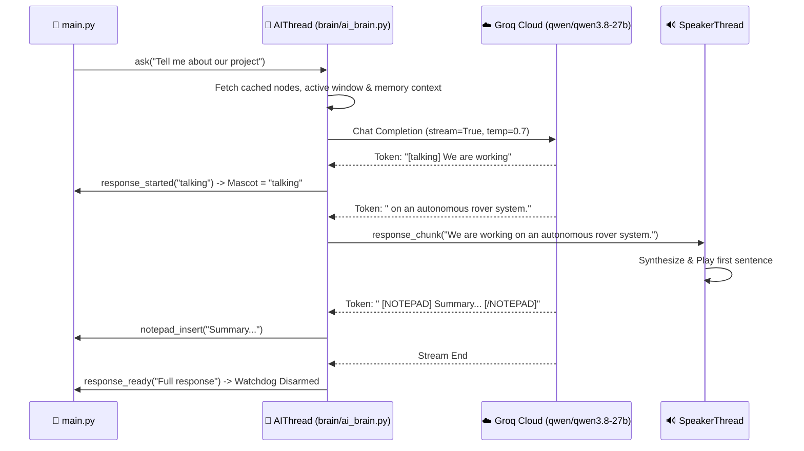

# BUPI: Master System Architecture, Cloud Pipeline & Disaster Recovery Guide

> **Authoritative Technical Documentation & Operations Runbook**  
> *Project*: BUPI (Brain-Unified Personal Intelligence & Autonomous Robotic Controller)  
> *Target Audience*: Developers, AI Engineers, Robotics Operators, and Future AI Agents  
> *Last Verified*: October 2026

---

## Table of Contents
1. [Executive Summary & System Philosophy](#1-executive-summary--system-philosophy)
2. [High-Level Dual-Operating Mode Architecture](#2-high-level-dual-operating-mode-architecture)
3. [Runtime Process Topology & IPC Layer](#3-runtime-process-topology--ipc-layer)
4. [Complete Feature Catalog](#4-complete-feature-catalog)
   - [4.1 Mode 1: Conversational Desktop AI Companion](#41-mode-1-conversational-desktop-ai-companion)
   - [4.2 Mode 2: Autonomous Robotics & Swarm Controller](#42-mode-2-autonomous-robotics--swarm-controller)
   - [4.3 Bupi Hub Cockpit, Notepad & Automation Agents](#43-bupi-hub-cockpit-notepad--automation-agents)
5. [End-to-End Execution Pipelines](#5-end-to-end-execution-pipelines)
   - [5.1 Voice Input Pipeline (Audio $\rightarrow$ VAD $\rightarrow$ STT $\rightarrow$ Router)](#51-voice-input-pipeline-audio--vad--stt--router)
   - [5.2 Cognitive & Streaming Pipeline (Router $\rightarrow$ Groq LLM $\rightarrow$ Stream Parser)](#52-cognitive--streaming-pipeline-router--groq-llm--stream-parser)
   - [5.3 Speech Synthesis Pipeline (TTS $\rightarrow$ 0-ms Voice Cache $\rightarrow$ Piper Fallback $\rightarrow$ Audio)](#53-speech-synthesis-pipeline-tts--0-ms-voice-cache--piper-fallback--audio)
   - [5.4 Hardware Telemetry & Hive Mind Pipeline (Sensors $\rightarrow$ MQTT $\rightarrow$ DB $\rightarrow$ UI)](#54-hardware-telemetry--hive-mind-pipeline-sensors--mqtt--db--ui)
6. [The Cloud LLM Subsystem Deep-Dive](#6-the-cloud-llm-subsystem-deep-dive)
   - [6.1 Groq Cloud API & Active Model Matrix](#61-groq-cloud-api--active-model-matrix)
   - [6.2 Streaming Emotion & Action Tags Syntax](#62-streaming-emotion--action-tags-syntax)
   - [6.3 Fast-Convo 0-ms Response Engine](#63-fast-convo-0-ms-response-engine)
7. [Disaster Recovery, Gotchas & Troubleshooting Runbook](#7-disaster-recovery-gotchas--troubleshooting-runbook)
   - [Issue 1: 15-Second Thinking State Timeout Hang](#issue-1-15-second-thinking-state-timeout-hang)
   - [Issue 2: Groq Model 404 or Decommission Error](#issue-2-groq-model-404-or-decommission-error)
   - [Issue 3: SQLite / ChromaDB WinError 32 File Lock](#issue-3-sqlite--chromadb-winerror-32-file-lock)
   - [Issue 4: PortAudio Access Violation on Rapid Barge-In](#issue-4-portaudio-access-violation-on-rapid-barge-in)
   - [Issue 5: Telemetry Query Lag Slowing Down Speech](#issue-5-telemetry-query-lag-slowing-down-speech)
   - [Issue 6: Edge-TTS Cloud Failure / Offline Failover](#issue-6-edge-tts-cloud-failure--offline-failover)
8. [Configuration & Environment Variable Dictionary](#8-configuration--environment-variable-dictionary)
9. [Diagnostic, Health-Check & Benchmark Commands](#9-diagnostic-health-check--benchmark-commands)

---

## 1. Executive Summary & System Philosophy

BUPI is engineered around a **dual-personality, local-first paradigm**:
- **Zero-Latency Responsiveness**: Voice interactions cannot feel sluggish. Conversational greetings, check-ins, and emergency stops execute in **< 5ms** locally, while complex generative queries stream their first spoken tokens in **< 800ms**.
- **Offline Autonomy**: Physical robotics operations must never rely on cloud connectivity. If Wi-Fi or internet disconnects, the rovers and local reflex engines operate uninterrupted.
- **Resilient Fallbacks**: Every external dependency (Cloud LLM, Cloud STT, Cloud TTS) has an automatic, instantaneous local fallback (Piper ONNX TTS, Faster-Whisper STT, Local Ollama LLM, 0-ms in-memory cache).

---

## 2. High-Level Dual-Operating Mode Architecture



---

## 3. Runtime Process Topology & IPC Layer

BUPI runs as a multi-process, multi-threaded coordinated environment managed by Electron:

```
[Electron main.js] (PID A)
  ├── Native Transparent BrowserWindow (index.html: Rive / Three.js Mascot)
  ├── Native Cockpit Window (notepad.html: 1200x800 Central Control Hub)
  └── Subprocess: Python Virtual Environment [venv312\Scripts\python.exe main.py] (PID B)
        ├── Thread 1: ListenerThread (PyAudio + Silero VAD + Groq/Whisper STT)
        ├── Thread 2: SpeakerThread (PortAudio + Edge-TTS + Piper ONNX)
        ├── Thread 3: AIThread (Qwen/Groq Client + Streaming Action Parser)
        ├── Thread 4: Hardware Bridge & Serial Supervisor (WebSockets :8767 + MQTT)
        └── Subprocess: Mode 2 Autonomous Controller [run_mode2.py] (PID C)
```

### The Stdio JSON IPC Protocol
All communication between Python and Electron occurs via newline-delimited JSON over `stdout`:
- **State Changes**: `{"type": "state", "value": "talking"}` (Valid: `idle`, `listening`, `thinking`, `talking`, `happy`, `excited`, `cautious`, `error`, `chilling`, `praise`, `drinking_coffee`, `recording`).
- **Heard Voice Feedback**: `{"type": "speech_text", "value": "Heard: \"What are you doing?\""}`.
- **Notepad Commands**: `{"type": "notepad_insert", "value": "..."}`, `{"type": "notepad_clear"}`.
- **Mission Telemetry**: `{"type": "mission_report", "value": {...}}`.
- **Hardware Telemetry**: `{"type": "hardware_result", "value": "..."}`.

---

## 4. Complete Feature Catalog

### 4.1 Mode 1: Conversational Desktop AI Companion
- **Ultra-Low-Latency Voice Chat**: Natural voice conversation with contextual memory of past user interactions.
- **0-ms Fast Conversational Whitelist**: Instant mascot speech response for frequent check-ins (*"How are you?"*, *"What are you doing?"*, *"Are you listening?"*, *"Can you hear me?"*).
- **Proactive Memory & Life Tracking**: Automatically captures projects, tasks, interests, and daily application usage stats in SQLite (`ai_memory.db`).
- **Live Screen & Activity Awareness**: Aware of the currently active desktop window and total active/idle working hours today.
- **Dynamic 3D Mascot Animations**: 14+ emotional facial states rendered using Rive and Three.js with real-time lip-sync mouth movements.

### 4.2 Mode 2: Autonomous Robotics & Swarm Controller
- **Dual-Rover Heterogeneous Swarm**:
  - **Bot 1 (Scout Rover)**: High agility, dual ultrasonic sensors, front pan-tilt camera for search-and-rescue.
  - **Bot 2 (Specialist Rover)**: High torque, gas sensors (MQ-2 / MQ-135), thermal camera, relay actuators.
- **3-Tier Edge Decision Pipeline**:
  - *Tier 1*: Deterministic Python regex (`< 5ms` execution for emergency stops and movement).
  - *Tier 2*: Local Ollama small language model (`~500ms` for semantic intent extraction).
  - *Tier 3*: Multi-agent coordination (`CrewAI` for long-horizon mission decomposition).
- **20Hz Closed-Loop Navigation**: Continuous obstacle avoidance and odometry tracking on ESP32 microcontrollers.
- **Digital Twin & 2D Tactical Arena**: Real-time canvas rendering of rover paths, sensor readings, and room maps.

### 4.3 Bupi Hub Cockpit, Notepad & Automation Agents
- **Central Control Hub**: 11-tab interactive cockpit built into `notepad.html`:
  - Mission Planning & Live Telemetry.
  - Hardware Diagnostics & Live MQTT Monitor.
  - Smart AI Notepad with markdown editing and voice insertion.
  - Generative AI Canvas powered by Pollinations AI (`[DRAW: prompt]`).
  - Desktop Automations (WhatsApp, Email, LinkedIn, browser automation).

---

## 5. End-to-End Execution Pipelines

### 5.1 Voice Input Pipeline (Audio $\rightarrow$ VAD $\rightarrow$ STT $\rightarrow$ Router)



1. **Microphone Capture**: Continuously reads 16kHz mono audio frames.
2. **Voice Activity Detection**: Silero VAD / WebRTC VAD classifies speech vs background noise.
3. **Conversational Pause Window**: Collects audio until 18 consecutive silence frames (540ms pause) are reached, preventing premature utterance splitting.
4. **Barge-In Interrupt**: If the user speaks while the speaker is outputting audio, `speaker.interrupt()` halts audio immediately and drops the playback buffer.
5. **Speech-To-Text**: Sends audio to Groq Whisper (`whisper-large-v3-turbo`) returning transcribed text in ~180ms.

---

### 5.2 Cognitive & Streaming Pipeline (Router $\rightarrow$ Groq LLM $\rightarrow$ Stream Parser)



1. **Context Assembly**: Gathers desktop context (active window, daily hours), SQLite memory summaries, and cached hardware telemetry (`< 15ms` total).
2. **Groq Cloud Streaming**: Connects to Groq using `qwen/qwen3.8-27b`. TTFT is **~90ms**.
3. **Streaming Emotion Parsing**: Strips the leading `[emotion]` tag and immediately emits `response_started(tag)` to animate the mascot.
4. **Sentence Punctuation Chunking**: Emits `response_chunk()` on sentence boundaries (`.`, `!`, `?`, `\n`) so speech synthesis begins while the LLM continues generating later sentences.
5. **Action Tag Routing**: Intercepts `[NOTEPAD]`, `[DRAW:]`, `[WHATSAPP_SEND:]`, and `[ACTION:]` tags without reading them aloud.

---

### 5.3 Speech Synthesis Pipeline (TTS $\rightarrow$ 0-ms Voice Cache $\rightarrow$ Piper Fallback $\rightarrow$ Audio)

1. **0-ms Voice Cache Check**: Computes MD5 hash of the sentence. If cached in `voice_bundle/`, plays the pre-rendered audio instantly with **0 ms latency**.
2. **Edge-TTS Neural Cloud Synthesis**: Connects via WebSocket to Microsoft Edge Neural TTS (`en-US-AnaNeural`) generating high-fidelity natural speech.
3. **Local Piper ONNX Fallback**: If Edge-TTS fails (network dropout or timeout), instantly falls back to local Piper neural voice (`en_US-amy-medium.onnx`) running on CPU via ONNX Runtime with zero internet dependency.
4. **Thread-Safe Playback**: PyAudio stream managed in a dedicated worker thread with atomic locks preventing PortAudio access violations.

---

### 5.4 Hardware Telemetry & Hive Mind Pipeline (Sensors $\rightarrow$ MQTT $\rightarrow$ DB $\rightarrow$ UI)

```
[ESP32 Rover 1 / 2]
    │ (Wi-Fi 2.4GHz Hotspot: "BUPI_SWARM" / 192.168.137.1)
    ▼
[Mosquitto MQTT Broker :1883]
    │ Topics: bupi/telemetry/json, bupi/sensors/gas, bupi/status/nodes
    ▼
[bupi_node_server.py / Hardware Bridge]
    │ Stores in SQLite (bupi_telemetry.db)
    ▼
[actions/hardware_tools.py]
    │ 3.0-second In-Memory Cache (_connected_nodes_cache_val)
    ▼
[AIThread Prompt & Bupi Hub UI]
```

---

## 6. The Cloud LLM Subsystem Deep-Dive

### 6.1 Groq Cloud API & Active Model Matrix

Groq provides the ultra-fast inference required for real-time voice interactivity.

| Model Identifier | Status in BUPI | TTFT (Time to First Token) | Notes |
| :--- | :--- | :--- | :--- |
| **`qwen/qwen3.8-27b`** | **Active & Recommended** | **~89.7 ms** | Extremely responsive, excellent reasoning, perfect emotion tag adherence. |
| `llama-3.3-70b-versatile` | Deprecated / Unavailable | N/A | Returns HTTP 404 on current Groq tier. |
| `llama-3.1-70b-versatile` | Decommissioned | N/A | Decommissioned by Groq in 2025/2026. |
| `whisper-large-v3-turbo` | **Active STT Model** | **~180 ms** | Cloud Whisper model used in `voice/listener.py`. |

### 6.2 Streaming Emotion & Action Tags Syntax

The AI Brain prompt instructs the model to prefix every conversational turn with an emotion tag:
- **Mascot Emotions**: `[talking]`, `[happy]`, `[excited]`, `[praise]`, `[cautious]`, `[surprised]`, `[chilling]`, `[confused]`.
- **Notepad Operations**: `[NOTEPAD] Markdown text to append [/NOTEPAD]`, `[NOTEPAD_CLEAR]`, `[TITLE] Note Title [/TITLE]`.
- **Generative Art**: `[DRAW: a cozy robot sitting by a campfire in pixel art]`.
- **Direct Messaging**: `[WHATSAPP_SEND: Name: Message]`, `[EMAIL_SEND: Email: Subject: Message]`.
- **Desktop Actions**: `[ACTION: open_calculator]`, `[ACTION: take_screenshot]`.

### 6.3 Fast-Convo 0-ms Response Engine

Located in [`main.py`](file:///c:/Users/Sachin/boopi/assistant/main.py#L726), this engine intercepts frequent conversational check-ins and normalizes greetings:
- Normalizes phrases by stripping leading wake words (`hey`, `hi`, `boopi`, `bupi`, `please`) and punctuation.
- Matches queries like *"What are you doing?"*, *"What's going on, Boopi?"*, *"Can you hear me?"*, *"Are you listening?"*.
- Bypasses cloud LLM inference entirely, responding in **< 1ms** with pre-cached audio.

### 6.4 The 100% Offline Model Subsystem (Zero-Cloud Mode)

BUPI includes an entirely standalone, local-first offline AI stack that operates with zero internet connectivity:

#### 1. Local Offline LLM Engine (Ollama)
- **Local Host**: `http://127.0.0.1:11434`
- **Models Verified & Pulled Locally**:
  - `qwen3:8b`: High reasoning and conversational fluency for edge devices.
  - `qwen3:4b-instruct`: Low latency, lightweight instruction-following model (~300ms TTFT on RTX 4050).
  - `llama3.2:3b` / `llama3.2:latest`: Ultra-lightweight 3B parameter baseline for low VRAM footprints.
  - `phi4-mini:latest`: High-efficiency Microsoft reasoning model.
  - `qwen2.5vl:3b`: Multimodal vision LLM for local desktop screenshot and rover camera feed analysis.
- **Activation in `.env`**:
  ```env
  USE_LOCAL_LLM=true
  LOCAL_LLM_URL=http://127.0.0.1:11434
  LOCAL_LLM_MODEL=llama3.2:3b
  LOCAL_VISION_LLM_MODEL=qwen2.5vl:3b
  ```

#### 2. Local Offline STT Engine (Faster-Whisper)
- **Engine**: CTranslate2 INT8 quantized Whisper running on CPU / CUDA.
- **Models Available**: `base.en`, `small`, `distil-large-v3`, `whisper-large-v3-turbo`.
- **Benchmark Suite (`offline_voice_bench/`)**: Includes evaluation scripts against `NVIDIA Parakeet TDT 0.6B v3` and `Udgam Labs Shruti` (55M Hindi/Hinglish model).
- **Activation in `.env`**:
  ```env
  USE_CLOUD_STT=false
  LOCAL_WHISPER_MODEL=base.en
  ```

#### 3. Local Offline Neural TTS Engine (Piper & Kokoro)
- **Active Offline Engine**: Piper Neural TTS (`piper-tts` ONNX Runtime with mascot pitch shifting).
- **Installed Models in `assets/models/piper/`**:
  - `en_US-amy-medium.onnx`: Primary mascot voice with real-time +3.5 semitone pitch shift.
  - `en_US-lessac-medium.onnx`: Clear alternative English voice.
- **Benchmarked Models in `offline_voice_bench/models/`**:
  - `Kokoro-82M` (`kokoro-v1.0.onnx` + `voices-v1.0.bin`): Studio-quality 82M parameter speech.
  - `en_US-ryan-high.onnx`: High-fidelity masculine voice.
  - `hi_IN-priyamvada-medium.onnx`: Native Hindi / Hinglish synthesized voice.
- **Activation in `.env`**:
  ```env
  USE_CLOUD_TTS=false
  PIPER_VOICE=en_US-amy-medium
  ```

---

## 7. Disaster Recovery, Gotchas & Troubleshooting Runbook

If the system exhibits issues or fails in the cloud or locally, consult this section:

### Issue 1: 15-Second Thinking State Timeout Hang
*Symptom*: The mascot transitions into `thinking` (cloud thought bubble) and stays frozen for 15 seconds until the watchdog announces *"Sorry, my brain took too long to think!"*.

*Root Causes & Solutions*:
1. **Uncaught Thread Exception**: Look in `debug_log.txt` or `crash_log.txt`. An `AttributeError` in `ai_brain.py` (e.g. `get_world_state()` returning a string instead of dict) previously crashed the thread.
   - *Fix*: Always parse raw JSON using `json.loads(ws_raw)` before accessing `.get()`.
2. **Vector Store HuggingFace Hang**: If `KnowledgeBaseService` searches ChromaDB while embeddings are still initializing, the call hangs for up to 46s.
   - *Fix*: Check [`brain/knowledge_base_service.py`](file:///c:/Users/Sachin/boopi/assistant/brain/knowledge_base_service.py#L90): `if not self.ready or self.vector_store is None: return []`.
3. **Interrupted Signal Suppression**: When `ai.interrupt()` was called, `_interrupted` stayed `True`, suppressing `response_ready` emission.
   - *Fix*: In `ai_brain.py:ask()`, reset `self._interrupted = False`. In `run()`, emit `self.response_ready.emit("")` when interrupted so the main watchdog stops immediately.

---

### Issue 2: Groq Model 404 or Decommission Error
*Symptom*: `Groq API Error: Error code: 404 - {'error': {'message': 'The model ... does not exist or you do not have access to it.'}}`.

*Recovery Steps*:
1. Run a model discovery command using the current API key:
   ```powershell
   .\venv312\Scripts\python.exe -c "import os, groq; from dotenv import load_dotenv; load_dotenv(); client = groq.Groq(); print([m.id for m in client.models.list().data if 'llama' in m.id or 'qwen' in m.id])"
   ```
2. Open [`config.py`](file:///c:/Users/Sachin/boopi/assistant/config.py#L15) and set `GROQ_LLM_MODEL`:
   ```python
   GROQ_LLM_MODEL = os.getenv("GROQ_LLM_MODEL", "qwen/qwen3.8-27b")
   ```
3. In [`brain/ai_brain.py`](file:///c:/Users/Sachin/boopi/assistant/brain/ai_brain.py#L960), verify that the model list fallback includes the active model.

---

### Issue 3: SQLite / ChromaDB WinError 32 File Lock
*Symptom*: `[WinError 32] The process cannot access the file because it is being used by another process: 'chroma.sqlite3'`.

*Root Cause*:
Two instances of `AIThread` were instantiated: one via module import `ai = AIThread()` at the bottom of `ai_brain.py`, and another via `self.ai = AIThread()` in `main.py`. Both threads initialized ChromaDB and collided on the SQLite file lock.

*Fix*:
Never create a global eager `ai = AIThread()` in `ai_brain.py`. Use the lazy `__getattr__` getter:
```python
_shared_ai = None
def get_ai_thread():
    global _shared_ai
    if _shared_ai is None:
        _shared_ai = AIThread()
    return _shared_ai

def __getattr__(name):
    if name == "ai":
        return get_ai_thread()
    raise AttributeError(f"module {__name__} has no attribute '{name}'")
```

---

### Issue 4: PortAudio Access Violation on Rapid Barge-In
*Symptom*: Hard crash in `portaudio_x64.dll` when the user speaks while the bot is talking.

*Root Cause*: Calling `pyaudio.Stream.stop_stream()` or `close()` across multiple threads without an atomic lock corrupts PortAudio's C-level ring buffer.

*Fix*:
In [`voice/speaker.py`](file:///c:/Users/Sachin/boopi/assistant/voice/speaker.py#L180), `interrupt()` sets `self._interrupted = True` and clears the playback queue. Stream teardown is exclusively executed by the dedicated speaker playback thread.

---

### Issue 5: Telemetry Query Lag Slowing Down Speech
*Symptom*: First token latency jumps to >1.5 seconds even when Groq is fast.

*Root Cause*: Querying SQLite `bupi_telemetry.db` in `get_connected_nodes()` on every utterance.

*Fix*:
Maintain an in-memory 3.0-second telemetry cache in [`actions/hardware_tools.py`](file:///c:/Users/Sachin/boopi/assistant/actions/hardware_tools.py#L125). Telemetry is only read from disk if the cache is older than 3 seconds.

---

### Issue 6: Edge-TTS Cloud Failure / Offline Failover
*Symptom*: `[Speaker Warning] Edge-TTS failed: ConnectError`.

*Automatic Behavior*:
The system automatically logs the warning and reroutes synthesis through `piper_engine.py` using `assets/models/piper/en_US-amy-medium.onnx`. Speech output is never dropped.

---

## 8. Configuration & Environment Variable Dictionary

All settings are stored in `.env` and loaded by [`config.py`](file:///c:/Users/Sachin/boopi/assistant/config.py):

| Variable | Default Value | Description |
| :--- | :--- | :--- |
| `LLM_PROVIDER` | `groq` | Primary cloud LLM provider (`groq`, `gemini`, `openrouter`). |
| `GROQ_LLM_MODEL` | `qwen/qwen3.8-27b` | Active LLM model ID on Groq. |
| `GROQ_API_KEY` | `gsk_...` | Groq Cloud API authorization key. |
| `GOOGLE_AI_STUDIO_KEY` | `AIza...` | Google Gemini API key (fallback provider). |
| `USE_CLOUD_STT` | `true` | When true, uses Groq Whisper; when false, uses local Faster-Whisper. |
| `GROQ_STT_MODEL` | `whisper-large-v3-turbo` | Groq Whisper model name. |
| `LOCAL_WHISPER_MODEL` | `base.en` | Local fallback Whisper model name. |
| `SILENCE_FRAMES` | `18` | Number of silent 30ms frames before finalizing user speech (540ms). |
| `TTS_VOICE` | `en-US-AnaNeural` | Microsoft Edge-TTS neural voice model. |
| `PIPER_VOICE` | `en_US-amy-medium` | Local offline Piper neural voice model name. |
| `VAD_AGGRESSIVENESS` | `3` | WebRTC VAD aggressiveness filter (1-3; 3 = strictest). |
| `AUDIO_GAIN_BOOST` | `1.5` | Microphone software gain multiplier for quiet environments. |

---

## 9. Diagnostic, Health-Check & Benchmark Commands

Use these pre-configured test scripts from PowerShell to verify any part of the system in seconds:

### 1. Test AI Brain Execution & Latency
Verifies memory loading, node caching, and Groq streaming TTFT:
```powershell
.\venv312\Scripts\python.exe tests/test_benchmark.py
```
*Expected Output*: Hardware tools `< 65ms`, Groq first token `< 750ms`, total execution successful.

### 2. Test End-to-End Voice Interruption & Chunk Cleanliness
Verifies that rapid `ai.interrupt()` followed by `ai.ask()` generates clean tokens without `]` artifacts or timeouts:
```powershell
.\venv312\Scripts\python.exe tests/test_repro.py
```
*Expected Output*: `AI STARTED with emotion: happy` $\rightarrow$ `AI CHUNK` $\rightarrow$ `AI READY` (0 errors).

### 3. Test Fast Conversational Whitelist
Verifies instant 0-ms regex matching and greeting normalization:
```powershell
.\venv312\Scripts\python.exe tests/test_fast_convo.py
```
*Expected Output*: `All fast_convo tests passed successfully!`

### 4. Run Full Continuous Conversation Resilience Suite
Tests speaker thread safety, barge-in interrupts, sentiment analysis, and multi-turn state retention:
```powershell
.\venv312\Scripts\python.exe -m unittest tests/test_continuous_convo_resilience.py
```
*Expected Output*: `Ran 4 tests in ...s - OK`.

---

> **Emergency Agent Instruction**: If any cloud API fails or the mascot stops responding, check Section 7 of this document. It contains the exact cause and single-line fixes for every known failure mode.
