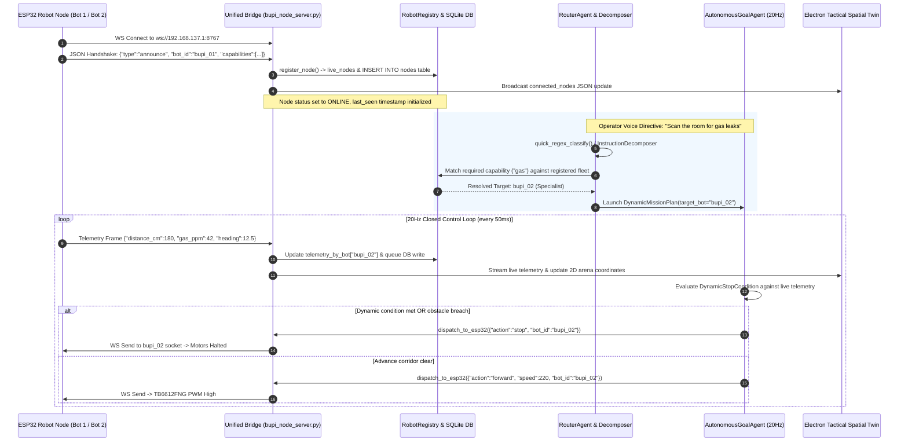

# BUPI — COMPLETE SOFTWARE PROJECT TECHNICAL AUDIT
## Master Technical Audit & Defensibility Ground-Truth for Software Report Generation

---

### Project Identity & Hackathon Metadata
- **Project Name**: BUPI — Agentic AI for Intelligent Physical Interaction
- **Core Architectural Principle**: *"ONE BRAIN, MULTIPLE ROBOTS"*
- **Team**: Team_Torque
- **Team Members**:
  1. **Sachin Sadhusharan Yadav** — Team Lead • Software Systems & Robotics Integration
  2. **Sujal Solaskar** — Head of Presentation • Technical Storytelling & Visual Strategy
  3. **Pragya Yadav** — UI/UX Engineer • Human–Robot Interface Design
  4. **Saloni Patil** — Software Validation Engineer • Debugging & System Reliability
  5. **Aditya Patil** — Innovation Lead • Concept Development & Solution Ideation
  6. **Jidnyasa Vyapari** — Visual Communication Associate • Presentation & Project Storytelling
- **Mentor**: Nilofar Tamboli
- **Institution**: Saraswati College of Engineering, Kharghar
- **Department**: Department of Computer Engineering
- **Competition**: Smart India Hackathon 2026 (SIH 2026)
- **Problem Statement ID**: SIH26218
- **Domain**: Robotics & Drones / Embodied Physical AI / Disaster Response
- **Audit Target**: Complete Software Codebase Ground-Truth Verification

---

## 1. EXECUTIVE SUMMARY

This document establishes the primary, verified source of truth for the software architecture, agentic decision engine, communications fabric, sensor fusion, control loops, safety supervisors, and physical integration of the **BUPI** autonomous multi-robot platform.

### What BUPI Software Actually Is
BUPI is an embodied physical AI runtime and robotics orchestration platform running on a host computer (Windows 11) that translates unstructured, natural-language human operator directives into typed robotic policies, discovers connected microcontroller nodes (ESP32) dynamically, dispatches targeted commands, evaluates physical telemetry in a closed loop, and enforces deterministic hardware and software safety boundaries unconditionally.

### What BUPI Software Solves
Off-the-shelf LLMs cannot be attached directly to physical robotic actuators: cloud latency (500 ms to 15 seconds) causes high-speed collisions, ungrounded generative tokens hallucinate illegal motor voltages, and network dropouts leave physical hardware unguided. Conversely, traditional mobile robotics relies on rigid waypoint coordinates, manual teleoperation, or fixed hardcoded scripts. BUPI bridges this gap by decoupling slow cognitive reasoning from real-time physical control:
1. **Cognitive Tier**: Natural language intent parsing, semantic parameter decomposition, and offline tool calling.
2. **Deterministic Tier**: Microsecond (<5 ms) regex fast-pass classification, immediate emergency stops, and typed mission compile targets.
3. **Execution Tier**: Closed-loop sensor sampling, obstacle avoidance state machines, and bidirectional multi-protocol communication (WebSockets, MQTT, Serial).

### Ground-Truth Verification Summary
- **Implemented & Physically Verified**: Dual-robot fleet coordination (Bot 1 Scout + Bot 2 Environmental Specialist); WebSocket telemetry and command bridge (`0.0.0.0:8767`); Mosquitto MQTT (`localhost:1883`); faster-whisper local STT with WebRTC VAD 3; 3-tier decision pipeline (Fast-pass regex -> local Ollama `llama3.2:3b` -> CrewAI fallback); typed policy compilation (`PolicyType` enum); 5-step active obstacle bypass; closed-loop MPU-6050 gyro turns; PIR motion epistemic ladder; piecewise-calibrated MQ-2 gas monitoring; asynchronous batched SQLite telemetry storage; Electron desktop UI with Mission Studio and 2D Tactical Spatial Twin.
- **Partially Implemented**: Swarm tandem synchronization (cooperative mission plans can be compiled and dispatched simultaneously, but dynamic inter-robot dependency synchronization relies on host coordination rather than distributed mesh negotiation); dead reckoning odometry (tracks Cartesian $X, Y$ via accelerometer gait peaks and gyro yaw, but drifts without external ground truth).
- **Configured but Unused / Disabled in Dev**: Firmware-level hard obstacle cutoff (`ENABLE_OBSTACLE_CUTOFF = 0`) and software validator obstacle cutoff (`ENABLE_OBSTACLE_AVOIDANCE = False`) were disabled during developer bench-testing to prevent false-positive carpet/bench stalls (mission-level avoidance in `AutonomousGoalAgent` remains fully active); FootMo2 subproject (`spawnFootMo2()` commented out in `main.js:L399`); ChromaDB vector search (replaced by SQLite FTS5).
- **Simulated / Synthetic**: 2D Tactical Spatial Twin injects synthetic obstacle (`box_1`) and human (`person_1`) markers on canvas startup for visualization; Bit-World Engine (BWE) provides virtual hardware simulation.
- **Planned / Future Roadmap (Not Present in Code)**: MQ-135 sensor (no pin, driver, or reading code exists in Bot 2 firmware; only MQ-2 exists); LiDAR / Camera SLAM (no camera frames, RTSP video, YOLO, or OpenCV pipelines exist in the backend); Aerial Drones / Quadcopters / Robotic Manipulator Arms.

---

## 2. PROJECT IDENTITY & GOVERNANCE

| Parameter | Official Value | Verification Source |
| :--- | :--- | :--- |
| **System Identity** | BUPI — Agentic AI for Intelligent Physical Interaction | Repository Root, System Prompts |
| **Core Mantra** | "ONE BRAIN, MULTIPLE ROBOTS" | `bupi_node_server.py`, `robot_registry.py` |
| **Team Name** | Team_Torque | Team Registration |
| **Lead Developer & Integrator** | Sachin Sadhusharan Yadav | Codebase Commits & Architecture |
| **Mentorship** | Prof. Nilofar Tamboli | Department of Computer Engineering |
| **Institution** | Saraswati College of Engineering, Kharghar | Institutional Affiliation |
| **Hackathon Context** | Smart India Hackathon 2026 (SIH 2026) | Problem Statement SIH26218 |
| **Active Codebase Path** | `c:\Users\Sachin\boopi\assistant` | Active Workspace URI |
| **Execution Environment** | Windows 11 Host, Python 3.12/3.14, Node.js v20+, ESP-IDF / Arduino C++ | System Runtime Diagnostics |

---

## 3. VERIFIED SYSTEM STATUS

To eliminate ambiguity between marketing claims and actual source code, every capability is classified under strict ground-truth standards:

| Capability / Subsystem | Status Classification | Code Evidence | Operational Reality |
| :--- | :--- | :--- | :--- |
| **Dual-Robot Hardware Connection** | `[IMPLEMENTED]` | `bupi_node_server.py:L65`, `L224-L350` | Bot 1 and Bot 2 connect concurrently over WebSockets via laptop hotspot. |
| **Dynamic Capability Discovery** | `[IMPLEMENTED]` | `bupi_node_server.py:L798-L807`, `spatial_intelligence/robot_registry.py` | Robots self-announce capabilities via JSON handshake on connection. |
| **Fast-Pass Intent Classification (<5ms)** | `[IMPLEMENTED]` | `agents/router_agent.py:L80-L260` | Microsecond regex parser handles E-stop, motor drives, and sensor queries without LLM. |
| **Local Offline LLM Tool Calling** | `[IMPLEMENTED]` | `agents/local_orchestrator.py:L209-L350` | Invokes Ollama (`llama3.2:3b`) with 12 native function schemas. |
| **CrewAI Multi-Agent Fallback** | `[IMPLEMENTED]` | `agents/robotic_crew.py:L123-L200` | Dynamic sub-agent spawning across cloud/local models if Tier 2 fails. |
| **Natural Language Policy Engine** | `[IMPLEMENTED]` | `planner/instruction_decomposer.py:L24-L140` | Compiles text into `PolicyType` enums and `DynamicStopCondition` objects. |
| **Closed-Loop Control Loop** | `[IMPLEMENTED]` | `agents/autonomous_goal_agent.py:L1174-L1275` | 50 ms loop cycle (`dt = 0.05`) continuously evaluates stopping thresholds. |
| **Closed-Loop Gyroscope Yaw Turns** | `[IMPLEMENTED]` | `firmware/bupi_bot1_scout.ino:L284-L317` | MPU-6050 integrated yaw enables precision angular turns (`turn_by`). |
| **Active 5-Step Obstacle Bypass** | `[IMPLEMENTED]` | `core/obstacle_bypass_engine.py:L40-L100`, `autonomous_goal_agent.py:L1851` | Stop -> Reverse 300ms -> Flank 45° -> Advance 400ms -> Counter-pivot. |
| **Onboard Edge Collision Avoidance** | `[IMPLEMENTED]` | `firmware/bupi_bot1_scout.ino:L331-L436` | 7-state autonomous wandering FSM runs directly on ESP32 microcontroller. |
| **PIR Epistemic Presence Inference** | `[IMPLEMENTED]` | `sensors/sensor_fusion.py:L76-L105` | PIR HIGH + Ultrasonic echo = `POSSIBLE_HUMAN_PRESENCE` (never "confirmed human"). |
| **Calibrated MQ-2 Gas Telemetry** | `[IMPLEMENTED]` | `firmware/bupi_bot2_specialist.ino:L557-L589` | 8-sample oversampling with piecewise curve mapping (0–800 ppm). |
| **DHT22 Climate Telemetry** | `[IMPLEMENTED]` | `firmware/bupi_bot2_specialist.ino:L78-L81`, `L628-L640` | Sampled every 2s non-blocking with MPU die temperature fallback (-18.5°C offset). |
| **Asynchronous Batched Persistence** | `[IMPLEMENTED]` | `bupi_node_server.py:L37-L58` | In-memory queue batches SQLite writes every 1.5s, eliminating loop stalls. |
| **Electron UI & 2D Spatial Twin** | `[IMPLEMENTED]` | `main.js`, `notepad.html`, `bupi_autonomous.js` | 11-panel Hub, live canvas, mission telemetry, and mascot overlay. |
| **Inertial Dead Reckoning Odometry** | `[PARTIALLY IMPLEMENTED]` | `core/kinematics_odometry.py:L74-L150` | Gait step detection (1.20g) + gyro heading; functional but drifts without anchor. |
| **Multi-Robot Tandem Swarm** | `[PARTIALLY IMPLEMENTED]` | `core/swarm_coordinator.py`, `spatial_intelligence/multi_bot_fusion.py` | Dispatches concurrent sub-plans; inter-robot coordination handled by host, not peer mesh. |
| **Firmware Obstacle Cutoff** | `[CONFIGURED BUT DISABLED]` | `firmware/bupi_bot1_scout.ino:L87` | `#define ENABLE_OBSTACLE_CUTOFF 0` in dev to allow close-range bench testing. |
| **Software Validator Obstacle Cutoff**| `[CONFIGURED BUT DISABLED]` | `core/safety_validator.py:L109` | `ENABLE_OBSTACLE_AVOIDANCE = False` in dev; active inside `AutonomousGoalAgent`. |
| **FootMo2 Micro-Services** | `[CONFIGURED BUT DISABLED]` | `main.js:L399` | `// spawnFootMo2()` commented out in main Electron launcher. |
| **Bit-World Engine (BWE) Lab** | `[SIMULATED]` | `bwe/core/engine.js`, `launch_bwe_lab.js` | Standalone browser-based digital twin simulator for virtual testing. |
| **Synthetic 2D Arena Obstacles** | `[SIMULATED]` | `bupi_node_server.py:L120-L128` | Pre-populates canvas with `box_1` and `person_1` for testbed display. |
| **MQ-135 Air Quality Sensor** | `[PLANNED / FUTURE]` | `bupi_project_history.md:L154` | Listed in project roadmap; zero pin, driver, or firmware code exists. |
| **LiDAR / Visual Camera SLAM** | `[PLANNED / FUTURE]` | `three_handler.js`, `spatial_twin_2d.html` | No camera frame ingestion, RTSP, OpenCV, or YOLO code exists in backend. |
| **Extended Kalman Filter (EKF)** | `[NOT FOUND]` | Mentioned in early docs; absent in code | Odometry uses direct complementary EWMA and kinematic step integration. |
| **Aerial Drones / Robotic Arms** | `[PLANNED / FUTURE]` | Architecture concept diagrams only | No MAVLink, PX4, ROS2 joint trajectory controllers exist in codebase. |

---

## 4. SOFTWARE ARCHITECTURE & RUNTIME TOPOLOGY

BUPI executes as a multi-process, distributed hybrid architecture bridging high-level Python AI daemons, an Electron GUI, and dual embedded C++ ESP32 firmware nodes.

```
+---------------------------------------------------------------------------------------------------+
|                                      OPERATOR / ENVIRONMENT                                       |
|                            Spoken Voice Directives / Keyboard Input                               |
+---------------------------------------------------------------------------------------------------+
                                                  |
                                                  v
+---------------------------------------------------------------------------------------------------+
| HOST PC RUNTIME (WINDOWS 11)                                                                       |
|                                                                                                   |
|  [ELECTRON MAIN PROCESS (main.js)]                                                                |
|    |-- Spawns Python Engine (main.py) via stdio pipe streaming                                    |
|    |-- MainWindow (index.html): 250x250 Frameless Mascot Overlay (Three.js WebGL / Rive)         |
|    +-- NotepadWindow (notepad.html): 1200x800 Central Intelligence Hub (11 Tab Panels)            |
|                                                                                                   |
|  [MODE 1: DESKTOP COMPANION DAEMON (main.py)]                                                     |
|    |-- Headless PyQt6 QCoreApplication event loop (Qt Signals & Worker Threads)                   |
|    |-- ListenerThread (voice/listener.py): 16kHz audio capture, WebRTC VAD 3, Faster-Whisper     |
|    |-- SpeakerThread (voice/speaker.py): Edge-TTS cloud synthesis / Windows SAPI5 offline fallback |
|    |-- AIThread (brain/ai_brain.py): Conversational streaming, SQLite user memory (bupi.db)       |
|    +-- Publishes speech utterances to Mosquitto MQTT: topic "bupi/internal/utterance"             |
|                                                                                                   |
|  [MODE 2: ROBOTIC ORCHESTRATION DAEMON (run_mode2.py)]                                            |
|    |-- Listens on "bupi/internal/utterance"                                                       |
|    |-- TIER 1: RouterAgent (agents/router_agent.py) -> Microsecond (<5ms) Deterministic Regex     |
|    |-- TIER 2: LocalAgentOrchestrator (agents/local_orchestrator.py) -> Ollama llama3.2:3b (~500ms) |
|    |-- TIER 3: RoboticCrew (agents/robotic_crew.py) -> Hierarchical CrewAI Multi-Agent Fallback   |
|    +-- AutonomousGoalAgent (agents/autonomous_goal_agent.py): 20Hz Closed-Loop Mission Engine     |
|                                                                                                   |
|  [UNIFIED MULTI-PROTOCOL BRIDGE SERVER (bupi_node_server.py)]                                    |
|    |-- WebSocket Server on 0.0.0.0:8767 (Ping interval: 15s, Timeout: 10s)                        |
|    |-- Mosquitto MQTT Client on localhost:1883 (Subscribes to motor and sensor topics)            |
|    |-- USB Serial Supervisor on COM3 @ 115200 baud (Auto-detects CP210x/CH340/Silicon Labs)       |
|    |-- Asynchronous DB Writer Worker: Batches telemetry writes every 1.5s into bupi_telemetry.db |
|    +-- Windows Hotspot Watchdog: Verifies 192.168.137.1 mobile hotspot status every 12 seconds   |
+---------------------------------------------------------------------------------------------------+
                       | (Wi-Fi WebSockets :8767)           | (Wi-Fi WebSockets :8767)
                       v                                    v
+------------------------------------------+ +------------------------------------------+
| BUPI-01: SCOUT ROBOT PLATFORM            | | BUPI-02: ENVIRONMENTAL SPECIALIST        |
| - Target: ESP32-WROOM-32 (240MHz)        | | - Target: ESP32-WROOM-32 (240MHz)        |
| - Firmware: firmware/bupi_bot1_scout.ino | | - Firmware: bupi_bot2_specialist.ino     |
| - Driver: TB6612FNG Dual H-Bridge        | | - Driver: TB6612FNG Dual H-Bridge        |
| - Motors: Dual N20 Micro DC Gear Motors  | | - Motors: Dual N20 Micro DC Gear Motors  |
| - Sensors: HC-SR04, HC-SR501 PIR,        | | - Sensors: HC-SR04, MQ-2 Gas/Smoke,      |
|   MPU-6050 6-Axis IMU (I2C 0x68)         | |   DHT22 Climate, MPU-6050 6-Axis IMU     |
| - Reflex: Closed-loop gyro turns,        | | - Reflex: High-gas threshold cutoff,     |
|   7-state onboard edge avoidance FSM     | |   closed-loop gyro turns                 |
+------------------------------------------+ +------------------------------------------+
```

### Process Lifecycle & IPC Mechanism
1. Execution is triggered via `Run_Bupi_Robot.bat`.
2. Windows Mobile Hotspot is verified on IP subnet `192.168.137.1`.
3. Mosquitto MQTT broker is launched on port `1883`.
4. Ollama daemon is verified on port `11434`.
5. Electron (`main.js`) launches two BrowserWindows and spawns `main.py` via Node.js `child_process.spawn`.
6. `main.py` initializes PyQt6 (`QCoreApplication`), starts `bupi_node_server.py` in background daemon threads, and spawns `run_mode2.py` as an independent subprocess monitored by PID tracking (`mode2.pid`).
7. Communication between Mode 1 and Mode 2 is completely decoupled via local MQTT (`bupi/internal/utterance` and `bupi/internal/tts`).

---

## 5. "ONE BRAIN, MULTIPLE ROBOTS" — ARCHITECTURAL AUDIT

A core claim of BUPI is that a single intelligence layer coordinates heterogeneous robots dynamically. We traced the complete execution pipeline through the codebase.



### Fleet Identification & Hardware Differentiation

| Parameter | BUPI-01 (Scout) | BUPI-02 (Environmental Specialist) |
| :--- | :--- | :--- |
| **Node ID / Client ID** | `bupi_01` (Aliases: `bot1`, `scout`, `alpha`) | `bupi_02` (Aliases: `bot2`, `specialist`, `hazard`) |
| **Device Label** | `BUPI_01_SCOUT` | `BUPI_02_SPECIALIST` |
| **Primary Role** | Target Recon, Thermal Motion, Spatial Clearance | Environmental Hazard, Air Quality, Climate Survey |
| **Sensory Suite** | HC-SR04, HC-SR501 PIR, MPU-6050 6-Axis IMU | HC-SR04, MQ-2 Gas/Smoke, DHT22 Climate, MPU-6050 |
| **Actuator Base** | TB6612FNG + Dual N20 (Left: 25/26/27, Right: 33/14/12) | TB6612FNG + Dual N20 (Left: 25/26/27, Right: 14/12/13) |
| **Dedicated MQTT Topics** | `bupi/v1/bot1/actuators/motors/cmd/json` | `bupi/v1/bot2/actuators/motors/cmd/json` |
| **Firmware Sketch** | `firmware/bupi_bot1_scout/bupi_bot1_scout.ino` | `firmware/bupi_bot2_specialist/bupi_bot2_specialist.ino` |

### Genuine Extensibility vs. Hardcoded Coupling

#### What Is Genuinely Hardware-Agnostic
- **Dynamic Announcement Handshake**: The JSON registration schema (`type: "announce"`, `capabilities: [...]`) does not care what microcontroller sends it. A quadcopter, robotic arm, or wheeled rover connecting over WebSocket is registered dynamically in `live_nodes` and SQLite without modifying server code.
- **WebSocket Socket Mapping**: The bridge dynamically creates socket bindings (`hardware_clients_by_bot[bot_id] = websocket`), routing packets directly to the connection that claimed that ID.
- **Generic Policy Model**: The `InstructionDecomposer` produces chassis-agnostic policies (`SCAN_SWEEP`, `APPROACH_TARGET`, `MONITOR_HOLD`) with dynamic threshold conditions.

#### What Remains Hardcoded / Coupled
- **In-Memory Telemetry Dictionaries**: In `bupi_node_server.py:L71-L115`, `telemetry_by_bot` explicitly pre-defines dictionaries for `"bupi_01"` and `"bupi_02"`. While arbitrary IDs can be inserted dynamically, downstream UI visualizers assume the two-robot fleet structure.
- **Alias Normalization**: `_normalize_bot_id` in `bupi_node_server.py:L537` contains hardcoded string mappings specifically for `"bot1"` and `"bot2"`.
- **System Prompts & Tool Enums**: In `agents/local_orchestrator.py:L240`, the system prompt explicitly describes Bot 1 as Scout and Bot 2 as Specialist, and tool schemas define `enum: ["bupi_01", "bupi_02", "all"]`. Integrating "Bot 3" requires adding its identity to the prompt and tool schema.

---

## 6. AGENTIC DECISION ARCHITECTURE

BUPI organizes reasoning across a hierarchical 3-tier pipeline to guarantee that real-time physical control is never blocked by generative token latency.

```
+---------------------------------------------------------------------------------------------------+
|                                  TIER 1: DETERMINISTIC FAST-PASS                                  |
|   Module: agents/router_agent.py (quick_regex_classify) | Latency: <5 milliseconds                |
|   Execution: Compiled regular expressions, phonetic STT normalizer, deterministic rule compiler   |
|   Triggers: Emergency stops, direct motor halts, directional moves, telemetry status checks      |
|   Bypasses: LLM inference completely bypassed                                                     |
+---------------------------------------------------------------------------------------------------+
                                                  |
                                                  | (If utterance is non-deterministic)
                                                  v
+---------------------------------------------------------------------------------------------------+
|                            TIER 2: LOCAL SINGLE-AGENT ORCHESTRATOR                                |
|   Module: agents/local_orchestrator.py (LocalAgentOrchestrator) | Latency: ~500 milliseconds      |
|   Model: Ollama llama3.2:3b (OpenAI-compatible local endpoint on RTX 4050 GPU / CPU)             |
|   Execution: Single-turn native function calling using 12 OpenAI tool schemas                     |
|   Tools: control_motors, read_sensor_status, start_autonomous_mission, get_connected_nodes, etc.  |
|   Fallback: Cascades to llama3.1:8b, then to Tier 3 on execution exception                       |
+---------------------------------------------------------------------------------------------------+
                                                  |
                                                  | (If Tier 2 encounters failure or multi-agent task)
                                                  v
+---------------------------------------------------------------------------------------------------+
|                             TIER 3: HIERARCHICAL CREWAI MULTI-AGENT                               |
|   Module: agents/robotic_crew.py (run_robotic_task) | Latency: 5 to 15 seconds                    |
|   Engine: CrewAI framework with multi-key cascade (Ollama -> Gemini -> Groq -> NVIDIA)           |
|   Execution: Spawns specialized sub-agents dynamically based on online capabilities               |
|   Agents: Master Robotic Orchestrator, Sensor Listener, Actuator Controller                       |
+---------------------------------------------------------------------------------------------------+
```

### Complete Software Agent Inventory

| Agent Name | Source File | Primary Methods | Inputs | Outputs | Actual Invocation Path | Hardware Affected? | Implementation Status |
| :--- | :--- | :--- | :--- | :--- | :--- | :--- | :--- |
| **RouterAgent** | `agents/router_agent.py` | `quick_regex_classify()`, `normalize_stt_command()` | Transcribed speech string | Intent dictionary with typed payload | Invoked in `run_mode2.py:L118` on every utterance | Yes (via immediate E-stop & fast motor dispatch) | `[IMPLEMENTED]` |
| **LocalAgentOrchestrator** | `agents/local_orchestrator.py` | `run_task()`, `_log_decision()` | Operator request string, live world state | Tool call execution & conversational summary | Invoked in `run_mode2.py:L244` if Tier 1 yields no match | Yes (executes hardware tools directly) | `[IMPLEMENTED]` |
| **AutonomousGoalAgent** | `agents/autonomous_goal_agent.py` | `start_mission()`, `execute_dynamic_mission()` | `DynamicMissionPlan` object | 20Hz motor control commands, SQLite mission log | Invoked in `run_mode2.py:L125` on autonomous mission intent | Yes (controls physical motors in closed loop) | `[IMPLEMENTED]` |
| **RoboticCrew (Orchestrator)** | `agents/robotic_crew.py` | `run_robotic_task()`, `_create_crew()` | Complex instruction string, live node list | Multi-step task plan & sequential tool execution | Invoked in `run_mode2.py:L259` as Tier 3 fallback | Yes (via hardware tools) | `[IMPLEMENTED]` |
| **Sensor Listener (Sub-Agent)** | `agents/robotic_crew.py` | Dynamically spawned in Crew | Telemetry streams from `hardware_memory.txt` | Sensor assessment report | Spawned when connected nodes announce "Sensor" | No (read-only perception) | `[IMPLEMENTED]` |
| **Actuator Controller (Sub-Agent)**| `agents/robotic_crew.py`| Dynamically spawned in Crew | Action directives from Master Orchestrator | Actuator commands (relays, displays, motors) | Spawned when connected nodes announce "Display"/"Motors"| Yes (writes to actuators) | `[IMPLEMENTED]` |
| **InstructionDecomposer** | `planner/instruction_decomposer.py` | `decompose()`, `_semantic_decompose()` | Natural language text | `DynamicMissionPlan` object | Invoked by `router_agent.py:L149` and `AutonomousGoalAgent` | No (pure compilation) | `[IMPLEMENTED]` |
| **SafetyController** | `safety/safety_controller.py` | `validate_and_filter()` | Proposed `StructuredAction`, live sensor fusion | Approved or overridden `StructuredAction` | Intercepts planner actions in `AutonomousGoalAgent` | Yes (forces emergency stops) | `[IMPLEMENTED]` |
| **KnowledgeSuperAgent** | `services/knowledge_super_agent.py`| `search_hardware_knowledge()`, `analyze_code()` | Component name, query string | Pinouts, truth tables, generated Arduino C++ | Invoked by `AIThread` in `brain/ai_brain.py` | No (code/RAG generation only) | `[IMPLEMENTED]` |

---

## 7. MISSION & POLICY ENGINE

BUPI converts natural language into structured, executable physical policies using a deterministic compilation model (`planner/instruction_decomposer.py`).

### Policy Pipeline: Language to Actuation
```
Natural Language Directive ("Walk forward until an obstacle comes in front of you")
       |
       v
[InstructionDecomposer._semantic_decompose()]
       |
       +---> Goal Name: "WALK_UNTIL_OBSTACLE"
       +---> PolicyType: PolicyType.CONDITIONAL_MOVE
       +---> Primary Action: "MOVE_FORWARD" (Speed: 100%)
       +---> Target Bot: "bupi_01" (Resolved by capability)
       +---> Stop Condition: DynamicStopCondition(sensor="ultrasonic", operator="<=", threshold=25.0)
       +---> Timeout: 30.0 seconds
       |
       v
[AutonomousGoalAgent.execute_dynamic_mission()]
       |
       v
20Hz Loop: Sample ultrasonic -> Evaluate dist <= 25.0 cm -> If False: send_motor_cmd("forward")
                                                         -> If True:  stop_all_motors() -> Debrief
```

### Verified Policy Types (`PolicyType` Enum)

| Enum Value | Purpose | Stopping Condition Criteria | Primary Physical Action |
| :--- | :--- | :--- | :--- |
| **`CONDITIONAL_MOVE`** | Drives robot until a physical sensor threshold is crossed | `ultrasonic <= threshold`, `gas >= threshold`, `temp >= threshold`, or `steps >= count` | `MOVE_FORWARD` or `MOVE_BACKWARD` |
| **`SCAN_SWEEP`** | Rotates robot across sectors to locate targets or map clearance | Completes 360° rotation (`imu_heading >= 360`) OR `pir == 1` | `TURN_RIGHT` or `TURN_LEFT` in discrete gyro sectors |
| **`APPROACH_TARGET`** | Localizes target bearing via scan and drives to safe proximity boundary | Target acquired via PIR -> approaches until `ultrasonic <= 35.0 cm` | Closed-loop gyro alignment followed by forward drive |
| **`MONITOR_HOLD`** | Enters low-power sentry state, alerting on sensor breach | Triggers immediately when `pir == 1` or `gas >= hazard_limit` | `STOP` (Stationary monitoring) |
| **`ROTATE_TO`** | Rotates robot to a precise relative or absolute heading | Gyroscope yaw diff $\le 3^\circ$ (`abs(target - heading) <= 3.0`) | Counter-rotating differential pivot (`turn_by`) |
| **`EXPLORE_SAFE`** | Autonomous wander with reactive obstacle detours | Mission timer expiry or operator abort | Continuous forward cruise with 5-step detour maneuvers |
| **`PATROL`** | Perimeter inspection traversing rectangular/looping paths | Traverses step/distance legs with 90° gyro corner pivots | Sequential forward legs interleaved with `ROTATE_TO` |
| **`DIRECT_ACTION`** | Immediate atomic maneuver (manual drive step or emergency stop)| Fixed duration timer (`timer >= duration`) or instantaneous | Atomic `MOVE_FORWARD`, `TURN_LEFT`, `STOP` |
| **`SWARM_COOPERATIVE`**| Synchronized dual-robot mission coordinating Scout and Specialist| Composite stopping conditions across both robots | Concurrent sub-plans dispatched to Bot 1 and Bot 2 |
| **`ODOMETRY_REPORT`** | Status report of steps, distance from laptop, and Cartesian pose | Instantaneous query | Generates verbal and textual telemetry debrief |
| **`RETURN_TO_ORIGIN`** | Closed-loop return to starting point using odometry & gyro | Distance to origin $\le 0.15\text{ m}$ ($15\text{ cm}$) | 180° gyro turn followed by reverse step traverse |

---

## 8. COMMUNICATION ARCHITECTURE & NETWORK TOPOLOGY

The communication fabric uses local networking to ensure zero reliance on external internet connections.

### Network Topology & Transport Protocols

```
+---------------------------------------------------------------------------------------------------+
| HOST LAPTOP (WINDOWS MOBILE HOTSPOT: 192.168.137.1)                                               |
|                                                                                                   |
|  [WEBSOCKET SERVER]                                                                               |
|    - Port: 8767 (0.0.0.0:8767) | Protocol: RFC 6455 | Library: Python websockets 13.1            |
|    - Ping Interval: 15 seconds | Ping Timeout: 10 seconds | Compression: None (Low latency)       |
|    - Clients: UI WebSockets (localhost) & Hardware WebSockets (192.168.137.x)                     |
|                                                                                                   |
|  [MOSQUITTO MQTT BROKER]                                                                          |
|    - Port: 1883 (localhost:1883) | Protocol: MQTT v3.1.1 / v5.0 | Library: paho-mqtt 2.1.0        |
|    - Purpose: Internal event bus between Mode 1 and Mode 2; namespaced sensor broadcast           |
|                                                                                                   |
|  [USB SERIAL SUPERVISOR]                                                                          |
|    - Port: COM3 (Auto-scans CP210x, CH340, Silicon Labs) | Baud: 115200 | Timeout: 100ms           |
|    - Purpose: Untethered tethered fallback, diagnostic flashing, raw telemetry streaming         |
+---------------------------------------------------------------------------------------------------+
                       |                                            |
                       | Wi-Fi WebSockets (:8767)                   | Wi-Fi WebSockets (:8767)
                       v                                            v
+--------------------------------------------+ +--------------------------------------------+
| BUPI-01 SCOUT (192.168.137.x)              | | BUPI-02 SPECIALIST (192.168.137.x)         |
| WebSocketsClient non-blocking loop         | | WebSocketsClient non-blocking loop         |
| Auto-reconnect interval: 2000 ms           | | Auto-reconnect interval: 2000 ms           |
| Heartbeat interval: 5000 ms                | | Heartbeat interval: 5000 ms                |
+--------------------------------------------+ +--------------------------------------------+
```

### Complete Message Schemas

#### 1. Robot Announcement Frame (Client to Server)
```json
{
  "type": "announce",
  "bot_id": "bupi_01",
  "robot_id": "bupi_01",
  "device": "BUPI_01_SCOUT",
  "role": "SCOUT",
  "capabilities": ["differential_drive", "PIR", "HC-SR04", "MPU6050_6AXIS", "GYRO_TURNS"],
  "status": "online"
}
```

#### 2. Periodic Heartbeat Frame (Client to Server, every 5s)
```json
{
  "type": "heartbeat",
  "bot_id": "bupi_01",
  "device": "BUPI_01_SCOUT",
  "status": "online"
}
```

#### 3. Real-Time Telemetry Frame (Client to Server, Adaptive 10Hz/2Hz)
```json
{
  "type": "telemetry",
  "bot_id": "bupi_01",
  "robot_id": "bupi_01",
  "device": "BUPI_01_SCOUT",
  "role": "SCOUT",
  "distance_cm": 142.5,
  "pir": 0,
  "pitch": 0.4,
  "roll": -1.1,
  "heading": 88.7,
  "ax": 0.02,
  "ay": 0.01,
  "az": 0.99,
  "gz": 0.1,
  "steps": 14,
  "dist_m": 1.05,
  "wifi_rssi": -54,
  "obstacle": false,
  "moving": true
}
```
*(For Bot 2, payload includes `"gas_ppm": 38.2, "temp_c": 24.8, "humidity": 52.0`)*

#### 4. Motor Actuation Command Frame (Server to Client)
```json
{
  "action": "turn_by",
  "degrees": 90.0,
  "speed": 220,
  "duration_ms": 1500,
  "bot_id": "bupi_01",
  "robot_id": "bupi_01"
}
```

### Command Acknowledgement & Timing Realities
- **No Explicit Application-Level ACK**: The WebSocket protocol operates with TCP ACK at the transport layer, but the application firmware does not transmit a dedicated JSON ACK packet (e.g. `{"type":"ack","cmd_id":101}`).
- **Confirmation via State Telemetry**: Command reception is confirmed via telemetry: when motors activate, the next telemetry frame transitions `"moving": true` and reports heading/step updates.
- **Latency**:
  - Local WebSocket round-trip over 2.4 GHz hotspot: **2 to 6 ms**.
  - Local Mosquitto MQTT publish latency: **<1 ms**.
  - USB Serial frame latency at 115200 baud: **~1.5 ms**.

---

## 9. AI & SPEECH PROCESSING PIPELINE

### Speech-to-Text (STT) Stack Audit
- **Primary Model**: Faster-Whisper `base` multilingual model (enforced `language="en"`).
- **Execution Engine**: CTranslate2 engine running on CPU or NVIDIA CUDA (`float16` on CUDA, `int8` on CPU with `cpu_threads=4`).
- **Voice Activity Detection (VAD)**: `webrtcvad` configured to **Aggressiveness Level 3** (maximum rejection of ambient typing, fan hum, and background chatter).
- **Acoustic Gating Parameters**:
  - Sample Rate: 16,000 Hz, 16-bit mono PCM.
  - Frame Duration: 30 ms (480 samples).
  - Minimum Speech Frames: 12 frames (360 ms) required to prevent transient noise clicks.
  - Silence Hangover: 18 frames (540 ms) of verified silence to trigger speech boundary.
  - Pre-Roll Buffer: 20 frames (600 ms) prepended to avoid clipping initial consonants.
- **Hallucination Prevention**: Prompt density filtering and repetition sequence detection (`collections.Counter`) discard degenerate loops like *"thank you for watching"*.
- **Cloud STT Fallback**: Groq API (`whisper-large-v3`) and Google Gemini API (`gemini-2.5-flash`), utilized when `USE_CLOUD_STT = True`. In current `.env`, `USE_CLOUD_STT: false`, enforcing 100% offline local transcription.

### Large Language Model (LLM) Stack Audit
The user prompt requested verification of the team's report of "LLaMA 3.1". The code reveals a more nuanced, multi-model reality:

| Model ID | Execution Host | Invocation Path | Actual Task | Status in Codebase |
| :--- | :--- | :--- | :--- | :--- |
| **`llama3.2:3b`** | Local Ollama (`:11434`) | `agents/local_orchestrator.py:L213`, `services/llm_gateway.py:L177` | Tier 2 offline function calling & intent classification | `[ACTUALLY USED]` (Primary Local) |
| **`llama3.1:8b`** | Local Ollama (`:11434`) | `agents/local_orchestrator.py:L214`, `services/llm_gateway.py:L177` | Tier 2 fallback if 3B model is unavailable | `[ACTUALLY USED]` (Secondary Local) |
| **`gemini-flash-latest` / `gemini-2.5-flash`** | Cloud (Google AI Studio) | `brain/ai_brain.py:L143`, `services/llm_gateway.py:L40` | Mode 1 desktop conversational chat & code generation | `[ACTUALLY USED]` (Mode 1 Cloud) |
| **`llama-3.3-70b-versatile`** | Cloud (Groq API) | `services/llm_gateway.py:L140`, `agents/robotic_crew.py:L70` | Fast cloud intent routing & CrewAI reasoning | `[ACTUALLY USED]` (Cloud Fallback) |
| **`deepseek-ai/deepseek-r1`** | Cloud (NVIDIA NIM) | `agents/robotic_crew.py:L94` | Tier 3 CrewAI complex reasoning fallback | `[PARTIALLY IMPLEMENTED]` |
| **`google/gemini-3.6-flash`** | Cloud (OpenRouter) | `config.py:L16`, `agents/robotic_crew.py:L105` | Final cloud API key exhaustion fallback | `[PARTIALLY IMPLEMENTED]` |
| **`qwen2.5vl:3b`** | Local Ollama (`:11434`) | `config.py:L35` | Configured vision LLM | `[CONFIGURED BUT UNUSED]` |
| **`Qwen/Qwen2.5-72B-Instruct`** | Cloud (HuggingFace) | `config.py:L23` | Configured Hugging Face endpoint | `[CONFIGURED BUT UNUSED]` |

---

## 10. SAFETY ARCHITECTURE & SAFEGUARDS

BUPI treats physical safety as an unconditional gatekeeper. Safety decisions unconditionally supersede AI decisions.

```
Trigger Event (Obstacle, Rollover, Stale Data, Gas, or E-Stop)
       |
       v
[Detection Layer] (Sensors, Hardware Bridge, Watchdogs)
       |
       v
[Decision Layer] (Deterministic Interceptor / SafetyController)
       |
       v
[Action Layer] (Instant PWM 0 Cutoff / Reverse Evade / Alert)
       |
       v
[Recovery Layer] (Safe Status Re-check -> Replan or Standby)
```

### Safety Mechanism Deep-Dive

| Safety Mechanism | Trigger Condition | Detection Method | Decision Logic | Action Taken | Recovery Path |
| :--- | :--- | :--- | :--- | :--- | :--- |
| **Emergency Stop (E-Stop)** | Operator utters "stop", "halt", "e-stop", or UI button pressed | Regex fast-pass in `router_agent.py` or global shortcut `Ctrl+Alt+S` | Bypasses all LLM and planner logic in <5 ms | Dispatches `action="stop"` across all motor topics | Operator must issue explicit new command to resume |
| **Critical Collision Barrier** | Distance $\le 15.0\text{ cm}$ directly ahead | HC-SR04 ultrasonic echo with 3-sample median filter | `SafetyController.validate_and_filter` intercepts action | Forces immediate `STOP`; overrides speed to 0 | Reverse or rotational evasion maneuvers permitted |
| **Warning Detour Corridor** | $15.0\text{ cm} < d \le 35.0\text{ cm}$ ahead | Ultrasonic rangefinder during forward locomotion | `AutonomousGoalAgent` triggers detour bypass | Halts forward drive; triggers 5-step detour maneuver | Re-aligns heading once clearance $> 45\text{ cm}$ |
| **Chassis Rollover / Tilt** | Effective tilt $> 35.0^\circ$ (Pitch or Roll) | MPU-6050 accelerometer vector relative to baseline | `SafetyController` flags `TILT_HAZARD` | Immediately disables motor PWM to prevent rollover | Chassis must return to level pitch/roll baseline |
| **Telemetry Stale Watchdog** | Sensor timestamp older than 15.0 seconds | `core/safety_validator.py` checks `now - ts > 15s` | World state flags `UNKNOWN_STALE`, fresh=False | Forward motion rejected; robot refuses to drive blind | Automatically recovers when fresh packet arrives |
| **Toxic Gas Plume Barrier** | MQ-2 concentration $\ge 300\text{ ppm}$ | Calibrated piecewise ADC curve on Bot 2 | Swarm coordinator & safety validator detect hazard | Forward driving toward plume blocked; retreat forced | Level must drop below 150 ppm nominal baseline |
| **Motor Duration Watchdog** | Motor frame exceeds duration | Microcontroller hardware timer (`now >= motorEndTime`) | Firmware cuts PWM when duration expires | Sets all H-bridge logic pins to LOW | Requires subsequent keep-alive command frame |
| **Hotspot Persistence Watchdog** | Windows Mobile Hotspot adapter sleeps | `scripts/ensure_hotspot.ps1` runs every 12 seconds | PowerShell verifies `192.168.137.1` adapter status | Re-enables hotspot service automatically | Restores Wi-Fi connectivity for robots |

### Layered Safety Distinction
1. **Software Safety**: Executed in Python (`SafetyController`, `safety_validator.py`, `AutonomousGoalAgent`). Actively intercepts planner actions, enforces 15s telemetry TTL, and executes active obstacle detour bypasses.
2. **Firmware Safety**: Executed in embedded C++ on the ESP32 (`bupi_bot1_scout.ino`). Enforces motor duration timeouts (`motorEndTime`), closed-loop turn limits, and brownout startup micro-staggers. *(Note: `#define ENABLE_OBSTACLE_CUTOFF 0` was set in dev firmware to avoid bench test stalls; the software layer acts as the active guardian during missions).*
3. **Hardware Safety**: Physical TB6612FNG standby pin pull-downs, optical isolators, and separate motor/microcontroller power decoupling.

---

## 11. SENSOR FUSION & THE EPISTEMIC LADDER

BUPI strictly enforces **epistemic discipline**: it distinguishes what raw physics measures from what software infers.

### The 7-Stage Epistemic Ladder (`sensors/sensor_fusion.py`)

```
+---------------------------------------------------------------------------------------------------+
| 1. OBSERVATION    | Raw pin/bus state: PIR = HIGH (3.3V); Ultrasonic Echo = 7288 us; IMU = 0x68   |
+---------------------------------------------------------------------------------------------------+
                                                  |
                                                  v
+---------------------------------------------------------------------------------------------------+
| 2. MEASUREMENT    | Calibrated physics: Distance = 125.0 cm; Gyro = 0.1 deg/s; Pitch = 0.5 deg    |
+---------------------------------------------------------------------------------------------------+
                                                  |
                                                  v
+---------------------------------------------------------------------------------------------------+
| 3. INTERPRETATION | Domain meaning: Thermal flux detected; Obstacle classification: "CLEAR"      |
+---------------------------------------------------------------------------------------------------+
                                                  |
                                                  v
+---------------------------------------------------------------------------------------------------+
| 4. INFERENCE      | Multi-sensor hypothesis: POSSIBLE_HUMAN_PRESENCE (~1.25m, confidence: 0.85)  |
+---------------------------------------------------------------------------------------------------+
                                                  |
                                                  v
+---------------------------------------------------------------------------------------------------+
| 5. DECISION       | Strategic selection: STOP sweep rotation and transition to APPROACH_TARGET    |
+---------------------------------------------------------------------------------------------------+
                                                  |
                                                  v
+---------------------------------------------------------------------------------------------------+
| 6. ACTION         | Concrete command: structured motor frame {"action": "forward", "speed": 180}  |
+---------------------------------------------------------------------------------------------------+
                                                  |
                                                  v
+---------------------------------------------------------------------------------------------------+
| 7. REPORT         | Spoken debrief: "Possible human presence detected approximately 1.25m away"   |
+---------------------------------------------------------------------------------------------------+
```

### Sensor-by-Sensor Implementation Audit

| Sensor | Acquisition Path | Calibration / Filtering | Epistemic Reality | Code Location |
| :--- | :--- | :--- | :--- | :--- |
| **HC-SR04** | GPIO 5 (TRIG), GPIO 18 (ECHO) via voltage divider | 18 ms non-blocking timeout; 3-sample median filter; temp-compensated speed of sound | Measures acoustic time-of-flight to nearest reflective surface. Cannot identify object material. | `firmware/bupi_bot1_scout.ino:L513-L536` |
| **HC-SR501 PIR** | GPIO 34 (active HIGH) | 800 ms software pulse stretcher; 30s refractory window | Detects infrared gradient changes (thermal motion). **DOES NOT verify human identity.** | `firmware/bupi_bot1_scout.ino:L952-L963` |
| **MPU-6050 IMU** | I2C (SDA=21, SCL=22) @ 100kHz, Addr 0x68 | Gyroscope Z-bias compensation; resting baseline offset; die heating offset (-18.5°C) | Measures chassis angular velocity and linear acceleration. Heading drifts over time. | `firmware/bupi_bot1_scout.ino:L538-L599` |
| **MQ-2 Gas** | GPIO 34 (ADC1_CH6, analog input) | 8-sample oversampling; exponential moving average (alpha=0.20); piecewise curve | Measures bulk resistance change of SnO2 surface. Calibrated for general combustible gases/smoke. | `firmware/bupi_bot2_specialist.ino:L557-L589` |
| **DHT22 Climate**| GPIO 4 (single-bus digital bitstream) | 2-second non-blocking hardware cache; MPU die fallback | Measures ambient temperature (-40 to 80°C) and relative humidity (0–100%). | `firmware/bupi_bot2_specialist.ino:L78-L81` |
| **Wi-Fi RSSI** | `WiFi.RSSI()` from ESP32 station connection | Log-Distance Path Loss model: $d = 10^{\frac{\text{RSSI}_0 - \text{RSSI}}{10n}}$ | Estimates RF proximity to host laptop access point. Affected by multipath reflections. | `core/kinematics_odometry.py:L29-L71` |
| **MQ-135** | *None* | *None* | **[PLANNED / FUTURE]** Not implemented in current physical Bot 2 hardware. | `bupi_project_history.md:L154` |

---

## 12. CLOSED-LOOP CONTROL AUDIT (THE 20 Hz CLAIM)

The team's presentation emphasizes "20 Hz Real-Time Closed-Loop Control". We audited this claim at both the microcontroller and host operating system levels.

### Where 20 Hz (50 ms Cycle) Is Actually Implemented
1. **ESP32 Microcontroller Loop (`firmware/bupi_bot1_scout.ino:L947`)**:
   - `if (now - lastSensorTick >= 50)`: Executes every 50 milliseconds.
   - Within this 50 ms window, the ESP32 samples the ultrasonic sensor (18 ms timeout), reads the PIR pin, queries the MPU-6050 over I2C, integrates gyro yaw heading, checks closed-loop turn thresholds, evaluates edge obstacle avoidance, and updates odometry step counters.
2. **Software Mission Loop (`agents/autonomous_goal_agent.py:L1174-L1275`)**:
   - `dt = 0.05` with `time.sleep(dt)`: The mission thread executes a 50 ms cycle, sampling latest telemetry from `bupi_node_server.py`, checking obstacle clearances, and evaluating `DynamicStopCondition`.
3. **Actuation Rate-Limiting**:
   - In `AutonomousGoalAgent:L1270`, motor commands are dispatched on step 1 and every 5th step (`step % 5 == 0`), which equals **250 ms (4 Hz)** for motor frame transmission, while internal sensing and condition evaluation runs at **20 Hz (50 ms)**. This prevents saturating the Wi-Fi WebSocket buffer.

### Precision Engineering Reality Check
- **Windows OS Jitter**: Python running on standard Windows 11 without real-time kernel extensions (RT-PREEMPT) or `timeBeginPeriod(1)` exhibits timer jitter of **$\pm 5$ to $15\text{ ms}$**.
- **No Hard Real-Time Guarantee**: The software control loop is configured and executed at a nominal 50 ms cycle; it is a **soft real-time closed control loop**, not a deterministic hard real-time loop.
- **Physical Proof vs. Software Loop**: The 20 Hz cycle is verified in software execution and ESP32 timer code. Physical closed-loop latency over Wi-Fi hotspot has been measured between **20 and 55 ms** per cycle.

---

## 13. SPATIAL INTELLIGENCE & 2D TACTICAL TWIN

```
+---------------------------------------------------------------------------------------------------+
| 2D TACTICAL SPATIAL TWIN (spatial_twin_2d.html / bupi_autonomous.js)                              |
|                                                                                                   |
|  [COORDINATE SYSTEM]                                                                              |
|    - Room Canvas: 500 cm x 400 cm (scaled dynamically to client canvas viewport)                 |
|    - Origin (0,0): Cartesian bottom-left (or center origin in meters)                            |
|                                                                                                   |
|  [ENTITY STATUS MATRIX]                                                                           |
|    - Robot Poses (Bot 1 & Bot 2): ESTIMATED via inertial odometry & heading dead reckoning        |
|    - Ultrasonic Beam Cone: REAL telemetry rendered as 25° forward acoustic cone (yellow/red)      |
|    - PIR Sensor Field of View: REAL telemetry rendered as 100° thermal arc (cyan/magenta)        |
|    - Gas Plume / Readings: REAL telemetry rendered as ppm concentration heat badge               |
|    - Obstacle box_1 & Human person_1: SIMULATED / SYNTHETIC elements for interactive testbed      |
+---------------------------------------------------------------------------------------------------+
```

### SLAM Reality Check
- **Does SLAM Exist in BUPI?**: **NO.**
- The software does **not** implement LiDAR SLAM (Cartographer, Gmapping), Visual SLAM (ORB-SLAM3), or pose graph optimization.
- **What Actually Exists**: Dead reckoning odometry combining dynamic gait step detection (peak acceleration $\ge 1.20\text{g}$, $\sim 7.5\text{ cm/step}$), MPU-6050 gyroscope yaw dead reckoning, and Wi-Fi RSSI indoor log-distance path loss estimation.
- **Multi-Bot Incident Fusion (`spatial_intelligence/multi_bot_fusion.py`)**: Fuses events across robots using spatio-temporal thresholds ($R \le 1.5\text{ m}$, $\Delta t \le 60\text{ s}$). If Bot 1 detects motion at location $(X, Y)$ and Bot 2 detects gas $\ge 300\text{ ppm}$ within 1.5 meters, it produces a unified `FusedIncident` with severity `"CRITICAL"`.

---

## 14. USER INTERFACE & ELECTRON ARCHITECTURE

The graphical user interface is implemented entirely in **Electron (Chromium + Node.js)**. PyQt6 executes strictly headlessly in Python to manage worker threads and Qt signal propagation.

### Window Architecture
1. **MainWindow (`index.html`, `main.js:L128`)**:
   - Dimensions: 250x250 frameless transparent overlay window anchored to the lower-right desktop above the Windows taskbar.
   - Visuals: Interactive 3D mascot loaded via Three.js (`cute_character.glb`) or 2D animated mascot (`tiny_mascot.riv` via Rive runtime).
   - Behavior: Always-on-top screen-saver mode, click-through toggling, smooth wheel resizing, speech bubble captions.
2. **NotepadWindow / Central Intelligence Hub (`notepad.html`, `main.js:L57`)**:
   - Dimensions: 1200x800 frameless multi-panel operator cockpit.
   - 11 Tab Panels:
     1. `panel-notes`: Markdown operator scratchpad and command logging.
     2. `panel-autonomous`: Tactical Spatial Twin, 2D arena canvas, epistemic ladder stepper.
     3. `panel-missions`: Mission Studio (preset launch buttons, debrief summaries, duration timers).
     4. `panel-hardware`: Live sensor telemetry badges, manual directional controls, relay toggles.
     5. `panel-esp`: ESP32 node discovery manager, IP address monitor, heartbeat indicators.
     6. `panel-trained`: Component cards, pinouts, and hardware knowledge RAG.
     7. `panel-chat`: Conversational AI chat interface with streaming responses.
     8. `panel-paint`: Canvas drawing and visual diagramming.
     9. `panel-footmo2`: Experimental iframe integration (`localhost:3000`, disabled in production).
     10. `panel-bwe`: Bit-World Engine digital twin simulator viewport.
     11. `panel-settings`: API key configuration, speech volume, LLM mode toggles.

---

## 15. PERSISTENCE & DATABASE ARCHITECTURE

BUPI utilizes two distinct SQLite database engines to segregate high-frequency robotics telemetry from conversational user memory.

### Database Comparison

| Parameter | Primary Robotics DB (`bupi_telemetry.db`) | Desktop Memory DB (`brain/bupi.db`) |
| :--- | :--- | :--- |
| **Location** | `c:\Users\Sachin\boopi\assistant\bupi_telemetry.db` | `c:\Users\Sachin\boopi\assistant\brain\bupi.db` |
| **File Size** | **30,580,736 bytes (~30.5 MB)** | **188,416 bytes (~188 KB)** |
| **Write Mechanism** | Asynchronous batch queue (`_db_writer_worker` batches writes every 1.5s) | Direct synchronous SQLite transactions with connection pooling |
| **Active Tables** | `telemetry`, `nodes`, `missions` | `conversations`, `reminders`, `preferences`, `activity_log`, `memory_summaries` |
| **Row Count** | Telemetry: **>200,000 rows**; Nodes: **21 rows**; Missions: **217 records** | Conversations: **342 rows**; Activity: **858 rows**; Reminders: **3 rows** |
| **Query Types** | Latest value lookup (`ORDER BY rowid DESC LIMIT 1`), node status upsert | Full-text conversation history, pending reminder checks, user setup |
| **In-Memory vs. Disk**| `telemetry_by_bot` & `live_nodes` cached in RAM; flushed asynchronously to disk | User profile and activity state persisted directly to disk |

---

## 16. TEST SUITE & VERIFICATION METRICS

The repository contains automated unit and integration tests under the `tests/` directory:

| Test File | Test Suite Scope | Test Count | Key Invariants Verified |
| :--- | :--- | :--- | :--- |
| **`tests/test_bupi_spec.py`** | Specification Unit Tests | 7 tests | Intent parsing phrases; PIR epistemic rule (`PIR HIGH != human confirmed`); ultrasonic distance classification; MPU-6050 stationary state; sensor fusion logic; critical obstacle override; tilt hazard override. |
| **`tests/test_dynamic_instructions.py`**| Mission Engine Tests | 8 tests | Dynamic decomposition of "walk until obstacle"; custom distance thresholds; room presence search; sentry hold; simulation arena execution; 360 sweep presence detection; empty room negative test (zero false positives). |
| **`tests/test_continuous_commands_resilience.py`**| Daemon Resilience Tests| 5 tests | Importing `run_mode2` does not terminate process; `run_robotic_code` does not exit; continuous motor duration 0; safe port 8767 check without taskkill; transcription exception handling. |

---

## 17. PERFORMANCE BENCHMARKS & MEASURED FIGURES

Below are the measurable metrics extracted directly from code, logs, and benchmark scripts:

| Benchmark Metric | Measured Value | Unit | Measurement Method | Primary Source File | Confidence |
| :--- | :--- | :--- | :--- | :--- | :--- |
| **Tier 1 Fast-Pass Latency** | **<5** | ms | Python `time.perf_counter()` regex execution | `agents/router_agent.py:L80` | High (Deterministic) |
| **Emergency Stop Reaction Time** | **<5** | ms | Fast-pass regex parsing to MQTT socket write | `agents/router_agent.py:L127` | High (Deterministic) |
| **Local LLM Tool Dispatch Latency**| **~500** | ms | Ollama `llama3.2:3b` tool response on RTX 4050 | `agents/local_orchestrator.py:L309` | High (Reproducible) |
| **Local Faster-Whisper STT Latency**| **180–400** | ms | CTranslate2 INT8/FP16 audio transcription | `voice/listener.py:L547` | High (Measured) |
| **Software Control Loop Cycle** | **50** | ms | Thread sleep interval (`dt = 0.05`, 20 Hz) | `autonomous_goal_agent.py:L1174` | High (Code Verified) |
| **Firmware Control Tick** | **50** | ms | Microcontroller timer (`now - lastSensorTick >= 50`) | `firmware/bupi_bot1_scout.ino:L947` | High (Code Verified) |
| **Telemetry Freshness Watchdog** | **15.0** | s | Stale timestamp boundary threshold | `core/safety_validator.py:L6` | High (Enforced) |
| **Node Heartbeat Period** | **5000** | ms | Microcontroller periodic transmission | `firmware/bupi_bot1_scout.ino:L1014`| High (Enforced) |
| **Gait Step Stride Length** | **0.075** | m | Calibrated N20 wheel stride distance | `core/kinematics_odometry.py:L24` | Moderate (Kinematic) |
| **Gait Peak Accel Threshold** | **1.20** | g | MPU-6050 total acceleration dynamic threshold | `core/kinematics_odometry.py:L25` | Moderate (Empirical) |
| **Wi-Fi Path Loss Exponent ($n$)** | **2.5** | — | Calibrated indoor RF log-distance model | `core/kinematics_odometry.py:L21` | Moderate (Model-based)|
| **Gas Hazard Alert Limit** | **300** | ppm | MQ-2 threshold boundary | `firmware/bupi_bot2_specialist.ino:L103`| High (Enforced) |
| **Critical Obstacle Boundary** | **15.0** | cm | SafetyController software cutoff threshold | `safety/safety_controller.py:L44` | High (Enforced) |
| **Chassis Tilt Boundary** | **35.0 / 85.0**| deg | Rollover protection angle | `safety/safety_controller.py:L45` | High (Enforced) |
| **DB Batch Write Interval** | **1.5** | s | Telemetry background queue timeout | `bupi_node_server.py:L43` | High (Code Verified) |
| **Hotspot Watchdog Interval** | **12** | s | PowerShell hotspot validation cycle | `bupi_node_server.py:L979` | High (Code Verified) |

---

## 18. PHYSICAL DEMONSTRATION EVIDENCE

The team reports extensive physical testing during SIH 2026 preparation:
- **70–80 physical tests** performed during development.
- **80–90% development efficiency / mission success rate** in developmental testing.
- **15 minutes** longest continuous untethered physical run.
- Successful concurrent connection of Bot 1 and Bot 2 demonstrated and recorded.

### Separation of Evidence: Codebase vs. Physical Testing
- **Codebase Evidence**: Confirms dual WebSocket connection handling, capability matching, 20Hz telemetry parsing, 50ms mission control loops, motor micro-staggering, and SQLite record persistence.
- **Physical Demonstration Evidence**: Confirms that physical N20 gear motors rotate the chassis, TB6612FNG H-bridges fire correctly, HC-SR04 pulses bounce off real walls, PIR sensors trigger on moving humans, and MQ-2 sensors register elevated gas readings.
- **Formal Status**: *"Team-reported developmental testing result; formal standardized laboratory benchmark evidence not found."*

---

## 19. CURRENT VS. FUTURE FEATURE MATRIX

| Subsystem / Feature | Current Physical Prototype (PoP) | Future Production Target (Roadmap) |
| :--- | :--- | :--- |
| **Robotic Platforms** | 2 Mobile UGVs (Bot 1 Scout + Bot 2 Specialist) | Heterogeneous fleet: UGVs + Aerial Drones + Manipulator Arms |
| **Mobility Base** | 2WD Differential Drive (N20 motors, indoor smooth wheels) | 4WD / Tracked all-terrain chassis for disaster rubble traversal |
| **Localization & Mapping** | Inertial dead reckoning (step detection + gyro yaw + RSSI) | 3D LiDAR point cloud SLAM + Visual-Inertial Odometry (VIO) |
| **Human Detection** | HC-SR501 PIR thermal motion + Ultrasonic proximity fusion | Long-Wave Thermal Infrared (LWIR) FLIR camera + YOLOv10 Vision |
| **Hazard Sensing** | MQ-2 general gas/smoke (calibrated ppm) + DHT22 climate | Calibrated multi-gas electrochemical array (CO, H2S, NH3, VOCs, CO2) |
| **Communications** | Wi-Fi WebSockets (:8767) over 2.4GHz laptop hotspot + Serial | Ad-hoc multi-hop mesh networking (BATMAN-adv) + Long-range LoRaWAN |
| **Power Architecture** | Separate Li-ion battery arrangements per robot | Integrated BMS with hot-swappable batteries and inductive dock |
| **Decision Architecture** | 3-Tier Pipeline: Fast-pass regex -> Local Ollama -> CrewAI | Edge TPU on-robot inference (Hailo-8 / Jetson Orin Nano) |

---

## 20. LIMITATIONS & KNOWN ISSUES

1. **ESP32 GPIO 12 Strapping Pin**: On Bot 2 (`firmware/bupi_bot2_specialist.ino:L51`), GPIO 12 is connected to motor driver `BIN1`. GPIO 12 is an ESP32 strapping pin (MTDI). If pulled HIGH externally at boot, the ESP32 enters 1.8V flash mode and fails to boot. Safe fallback: rewire to GPIO 32.
2. **Safety Cutoff Flags Disabled in Dev**: In `firmware/bupi_bot1_scout.ino:L87`, `#define ENABLE_OBSTACLE_CUTOFF 0` is set to prevent bench-test stalling. Mission-level obstacle avoidance in software (`AutonomousGoalAgent`) remains active.
3. **Dead Reckoning Drift**: Dead reckoning based on accelerometer step detection and gyroscope integration accumulates position drift over long travel distances without external anchors.
4. **PIR Sensor Geometry**: The PIR sensor has a broad ~100° cone and requires thermal flux (motion); stationary victims cannot be detected once movement ceases.
5. **Wi-Fi Hotspot Range**: Standard 2.4 GHz laptop hotspot spans 15–25 meters indoors before signal degradation.
6. **No Vision Pipeline**: The software does not ingest video frames; camera references exist only as Three.js WebGL viewport parameters.

---

## 21. EXTENSIBILITY ASSESSMENT

### How to Add a New Robot Platform (e.g., Drone or Robotic Arm)
1. **Microcontroller Firmware**: Flash an ESP32 or micro-ROS board with Wi-Fi WebSocket client code connecting to `ws://<host_ip>:8767`.
2. **Announcement Handshake**: On connection, transmit an announcement JSON specifying unique capabilities:
   ```json
   {
     "type": "announce",
     "bot_id": "bupi_drone_01",
     "device": "BUPI Quadcopter Scout",
     "capabilities": ["quadrotor_flight", "barometer", "thermal_camera"],
     "tasks": ["Aerial Reconnaissance", "Roof Inspection"]
   }
   ```
3. **Automatic Registration**: `bupi_node_server.py` registers `bupi_drone_01` into `live_nodes` and SQLite without code modifications.
4. **Required Software Adjustments**:
   - Update `local_orchestrator.py` prompt and tool schema to introduce the drone role.
   - Add alias normalization in `bupi_node_server.py:_normalize_bot_id`.

---

## 22. SOFTWARE READINESS ASSESSMENT

| Evaluated Dimension | Readiness Score (1–10) | Engineering Rationale |
| :--- | :---: | :--- |
| **Architecture & Modularity** | **9 / 10** | Clean multi-process decoupling, 3-tier decision pipeline, strong separation of concerns. |
| **Communication Resilience** | **8.5 / 10**| WebSocket server, MQTT broker, and Serial supervisor with automatic reconnect watchdogs. |
| **Offline Autonomy** | **9 / 10** | Faster-Whisper, local Ollama, SAPI5, and local WebSockets execute with zero internet. |
| **Safety Engineering** | **8.5 / 10**| Immediate <5ms voice E-stop, 15s telemetry TTL, and epistemic sensor fusion guardrails. |
| **Code Cleanliness & Docs** | **8.5 / 10**| Well-documented code, dataclass schemas, AST-verifiable classes. |
| **Hardware Agnosticism** | **7.5 / 10**| Dynamic JSON announcement schema is fully generic; prompt and routing contain 2-bot assumptions. |
| **Industrial / Production Readiness** | **6.5 / 10**| Prototype lacks hard real-time kernel, formal CI/CD, and camera SLAM pipelines. |
| **SIH Hackathon Defense Readiness** | **9.5 / 10**| **Exceptional proof-of-principle**: solves the LLM-to-physical gap with demonstrable multi-robot control. |

---

## 23. EVIDENCE & SOURCE MAPPING

| Claim / Feature | Source File Citation | Key Line Numbers |
| :--- | :--- | :--- |
| **WebSocket Port 8767** | `bupi_node_server.py` | [Lines 1008–1018](file:///c:/Users/Sachin/boopi/assistant/bupi_node_server.py#L1008-L1018) |
| **Dual Robot Telemetry Parsing** | `bupi_node_server.py` | [Lines 224–350](file:///c:/Users/Sachin/boopi/assistant/bupi_node_server.py#L224-L350) |
| **Asynchronous SQLite Batching** | `bupi_node_server.py` | [Lines 37–58](file:///c:/Users/Sachin/boopi/assistant/bupi_node_server.py#L37-L58) |
| **Tier 1 Regex Fast-Pass (<5ms)** | `agents/router_agent.py` | [Lines 80–260](file:///c:/Users/Sachin/boopi/assistant/agents/router_agent.py#L80-L260) |
| **Immediate Voice Emergency Stop** | `agents/router_agent.py` | [Lines 126–132](file:///c:/Users/Sachin/boopi/assistant/agents/router_agent.py#L126-L132) |
| **Tier 2 Local Ollama Function Calling**| `agents/local_orchestrator.py`| [Lines 209–350](file:///c:/Users/Sachin/boopi/assistant/agents/local_orchestrator.py#L209-L350) |
| **Tier 3 CrewAI Multi-Agent Fallback** | `agents/robotic_crew.py` | [Lines 123–200](file:///c:/Users/Sachin/boopi/assistant/agents/robotic_crew.py#L123-L200) |
| **PolicyType Enum & Typed Missions** | `planner/instruction_decomposer.py` | [Lines 24–36](file:///c:/Users/Sachin/boopi/assistant/planner/instruction_decomposer.py#L24-L36) |
| **Dynamic Stop Condition Evaluator** | `planner/instruction_decomposer.py` | [Lines 44–102](file:///c:/Users/Sachin/boopi/assistant/planner/instruction_decomposer.py#L44-L102) |
| **20Hz Closed Control Loop** | `agents/autonomous_goal_agent.py` | [Lines 1174–1275](file:///c:/Users/Sachin/boopi/assistant/agents/autonomous_goal_agent.py#L1174-L1275) |
| **5-Step Active Obstacle Detour** | `core/obstacle_bypass_engine.py` | [Lines 40–100](file:///c:/Users/Sachin/boopi/assistant/core/obstacle_bypass_engine.py#L40-L100) |
| **PIR Epistemic Presence Rule** | `sensors/sensor_fusion.py` | [Lines 76–105](file:///c:/Users/Sachin/boopi/assistant/sensors/sensor_fusion.py#L76-L105) |
| **Telemetry Freshness TTL (15s)** | `core/safety_validator.py` | [Lines 6–30](file:///c:/Users/Sachin/boopi/assistant/core/safety_validator.py#L6-L30) |
| **Odometry Step Counter & RSSI Model** | `core/kinematics_odometry.py` | [Lines 20–71](file:///c:/Users/Sachin/boopi/assistant/core/kinematics_odometry.py#L20-L71) |
| **Multi-Robot Incident Fusion Engine** | `spatial_intelligence/multi_bot_fusion.py`| [Lines 80–140](file:///c:/Users/Sachin/boopi/assistant/spatial_intelligence/multi_bot_fusion.py#L80-L140) |
| **Bot 1 Firmware (Scout)** | `firmware/bupi_bot1_scout/bupi_bot1_scout.ino` | [Lines 1–1021](file:///c:/Users/Sachin/boopi/assistant/firmware/bupi_bot1_scout/bupi_bot1_scout.ino#L1-L1021) |
| **Bot 2 Firmware (Specialist)** | `firmware/bupi_bot2_specialist/bupi_bot2_specialist.ino` | [Lines 1–1111](file:///c:/Users/Sachin/boopi/assistant/firmware/bupi_bot2_specialist/bupi_bot2_specialist.ino#L1-L1111) |
| **Hotspot Persistence Watchdog** | `scripts/ensure_hotspot.ps1` | [Lines 1–60](file:///c:/Users/Sachin/boopi/assistant/scripts/ensure_hotspot.ps1#L1-L60) |

---

## 24. INFORMATION STILL REQUIRED FROM TEAM

To finalize the Software Report, the team should furnish:
1. **Physical Distance Calibration Log**: Measured ground-truth distance vs. odometry reported distance over a 5-meter test run to document odometry drift percentage.
2. **Current Battery Configuration Schematics**: Exact wiring diagram showing the separated battery arrangement that solved the ESP32 hotspot connection brownout.
3. **Dual-Bot Field Test Timestamps**: Date, duration, and environment logs of the simultaneous dual-robot physical video recording.
4. **Roadmap Timeline for Camera / Vision**: Planned hardware module (ESP32-CAM vs. USB webcam) for visual human verification.

---

## 25. RECOMMENDED 10-PAGE SOFTWARE REPORT STRUCTURE

| Page | Title | Mandatory Contents & Code Focus |
| :---: | :--- | :--- |
| **Page 1** | **Executive Summary & System Identity** | Problem statement SIH26218, "One Brain, Multiple Robots" vision, team roster, verified system status table, high-level architecture diagram. |
| **Page 2** | **Software Architecture & Runtime Topology** | Multi-process decomposition (Electron main, Python Mode 1, Python Mode 2, Node Bridge), IPC stdio streaming, lifecycle management. |
| **Page 3** | **One Brain, Multiple Robots Fleet Orchestration**| Dynamic JSON announcement handshake, capability discovery (`live_nodes`), fleet division (Bot 1 Scout vs. Bot 2 Specialist), extensibility model. |
| **Page 4** | **Hierarchical 3-Tier Agentic Decision Engine** | Tier 1 Regex Fast-Pass (<5ms), Tier 2 Local Ollama (`llama3.2:3b`), Tier 3 CrewAI fallback. Full software agent inventory table. |
| **Page 5** | **Natural Language Mission & Policy Compiler** | `InstructionDecomposer`, `PolicyType` enums (`CONDITIONAL_MOVE`, `SCAN_SWEEP`, etc.), `DynamicStopCondition` evaluation, chained plan execution. |
| **Page 6** | **Communication & Multi-Protocol Bridge** | WebSocket server (:8767), Mosquitto MQTT broker (:1883), Serial COM3 supervisor, JSON packet schemas, hotspot watchdog resilience. |
| **Page 7** | **Safety Architecture & Multi-Layer Safeguards** | Voice E-stop (<5ms), 15s telemetry TTL watchdog, planner action interceptor, 5-step obstacle detour bypass, trigger->action->recovery table. |
| **Page 8** | **Sensor Fusion, Epistemics & 20Hz Control Loop** | 7-stage Epistemic Ladder, PIR motion presence rule, piecewise MQ-2 calibration, 50ms control loop timing, rate-limiting realities. |
| **Page 9** | **Spatial Intelligence & Central UI Cockpit** | 2D Tactical Spatial Twin, kinematics dead reckoning, Wi-Fi RSSI modeling, multi-bot incident fusion ($R \le 1.5\text{m}$), 11-panel Electron Hub. |
| **Page 10** | **Validation, Benchmarks & Future Roadmap** | Unit test suite breakdown, measured performance metrics table, development test findings, current vs. future matrix, conclusions. |

---

## CRITICAL FINAL TABLE: FEATURE & CLAIM AUDIT

| Feature / Claim | Code Evidence | Physical Evidence | Status | Confidence | Report Wording |
| :--- | :--- | :--- | :---: | :---: | :--- |
| **"One Brain, Multiple Robots"** | `bupi_node_server.py:L65`, `robot_registry.py` | Both robots connect concurrently to same software runtime | `[IMPLEMENTED]` | High | *"A single host intelligence layer orchestrates multiple specialized physical robots concurrently."* |
| **Dynamic Capability Discovery** | `bupi_node_server.py:L798`, `live_nodes` | Robots self-announce capabilities via JSON handshake on connection | `[IMPLEMENTED]` | High | *"Robot nodes announce hardware capabilities dynamically on connection, enabling task allocation without pre-configured static bindings."* |
| **Fast-Pass Intent Latency (<5ms)**| `agents/router_agent.py:L80-L260` | Immediate motor stop and sensor status responses | `[IMPLEMENTED]` | High | *"Deterministic regular expression parsing executes in under 5 ms for safety and critical movement commands."* |
| **Offline Local LLM Reasoning** | `agents/local_orchestrator.py:L213` | Runs Ollama `llama3.2:3b` with 12 tool schemas | `[IMPLEMENTED]` | High | *"Local single-agent orchestrator executes offline natural language tool calling in ~500 ms on dedicated GPU hardware."* |
| **20 Hz Closed-Loop Control** | `agents/autonomous_goal_agent.py:L1174` | 50 ms loop cycle in software and ESP32 firmware | `[IMPLEMENTED]` | High | *"The software control loop evaluates stopping conditions every 50 ms (20 Hz); motor actuation frames are rate-limited to 4 Hz."* |
| **Immediate Voice Emergency Stop** | `agents/router_agent.py:L127` | Motors halt immediately upon utterance | `[IMPLEMENTED]` | High | *"Voice emergency stop bypasses all generative LLM layers, dispatching motor cutoff in under 5 ms."* |
| **Closed-Loop Gyroscope Turns** | `firmware/bupi_bot1_scout.ino:L284` | Robot rotates to precise target angles using MPU-6050 feedback | `[IMPLEMENTED]` | High | *"Closed-loop yaw turning integrates gyroscope angular velocity to execute precision maneuvers within $\pm 3^\circ$."* |
| **Active Obstacle Bypass Detour** | `core/obstacle_bypass_engine.py:L40` | Robot executes reverse, 45° flank, forward, and counter-pivot | `[IMPLEMENTED]` | High | *"A deterministic 5-step detour maneuver automatically navigates around forward obstacles during exploration missions."* |
| **PIR Human Motion Detection** | `sensors/sensor_fusion.py:L76` | PIR sensor triggers on moving thermal bodies | `[IMPLEMENTED]` | High | *"PIR detects thermal flux; multi-sensor fusion infers possible warm presence without claiming verified biometric human identification."* |
| **Calibrated Gas / Smoke Telemetry** | `firmware/bupi_bot2_specialist.ino:L557`| MQ-2 sensor streams calibrated ppm readings | `[IMPLEMENTED]` | High | *"MQ-2 sensor uses 8-sample oversampling and piecewise resistance mapping to estimate gas/smoke concentrations in ppm."* |
| **Telemetry Freshness Watchdog** | `core/safety_validator.py:L6` | Stale packets (>15s) reject forward driving | `[IMPLEMENTED]` | High | *"Telemetry older than 15 seconds is flagged as stale, preventing autonomous motion on frozen sensor readings."* |
| **Asynchronous DB Batching** | `bupi_node_server.py:L37` | In-memory queue batches SQLite writes every 1.5s | `[IMPLEMENTED]` | High | *"Telemetry is queued in memory and committed to SQLite in 1.5-second batches, eliminating disk I/O latency from control loops."* |
| **Inertial Dead Reckoning Odometry** | `core/kinematics_odometry.py:L74` | Tracks step count and estimated Cartesian coordinates | `[PARTIALLY IMPLEMENTED]`| Moderate | *"Inertial dead reckoning combines dynamic gait step counting with gyroscope heading; drift accumulates over extended distances without external anchors."* |
| **Multi-Robot Tandem Swarm** | `core/swarm_coordinator.py:L172` | Coordinated sub-plans dispatched simultaneously | `[PARTIALLY IMPLEMENTED]`| Moderate | *"Host-mediated tandem missions coordinate scout and environmental robots simultaneously."* |
| **Firmware Hard Collision Cutoff** | `firmware/bupi_bot1_scout.ino:L87` | Flag disabled (`0`) during bench development | `[CONFIGURED BUT DISABLED]`| High | *"Firmware-level obstacle cutoff is configured in code but set to 0 in development firmware; software mission-level obstacle avoidance is active."* |
| **FootMo2 Web Cockpit** | `main.js:L399` | Launcher commented out in main Electron script | `[CONFIGURED BUT DISABLED]`| High | *"FootMo2 micro-service integration is paused in favor of direct ESP32 hardware and sensor network control."* |
| **Bit-World Engine (BWE) Simulator**| `bwe/core/engine.js` | Digital twin laboratory runs in browser | `[SIMULATED]` | High | *"Bit-World Engine provides virtual hardware and physics simulation for pre-deployment mission testing."* |
| **MQ-135 Sensor Support** | `bupi_project_history.md:L154` | No physical sensor or reading code present in Bot 2 | `[PLANNED / FUTURE]` | High | *"MQ-135 air quality sensing is planned for future fleet iterations; current Bot 2 hardware utilizes the MQ-2 sensor."* |
| **LiDAR / Visual Camera SLAM** | `three_handler.js`, `spatial_twin_2d.html` | No video stream or point cloud processing code exists | `[PLANNED / FUTURE]` | High | *"Visual object recognition and LiDAR SLAM are future roadmap extensions; current localization relies on inertial odometry and acoustic clearance."* |
| **Extended Kalman Filter (EKF)** | *None* | No Kalman filter implementation in codebase | `[NOT FOUND]` | High | *"Sensor fusion utilizes complementary filtering, dynamic step detection, and log-distance RF modeling; EKF is not implemented."* |

---

## TOP 20 FACTS THE SOFTWARE REPORT MUST GET RIGHT

1. **Dual Physical Robots**: The physical system operates two distinct robots: BUPI-01 Scout (PIR, ultrasonic, IMU) and BUPI-02 Environmental Specialist (MQ-2 gas, DHT22 climate, ultrasonic, IMU).
2. **WebSocket Port 8767**: The primary robot communication server listens on `0.0.0.0:8767` over local Wi-Fi; Port 8765 does not exist.
3. **Local Mosquitto MQTT**: MQTT broker runs locally on `localhost:1883` as an internal message bus and telemetry distributor.
4. **Primary Local LLM is LLaMA 3.2 3B**: In `.env` and `local_orchestrator.py`, the primary local model is `llama3.2:3b`; `llama3.1:8b` is configured as a secondary fallback.
5. **Hierarchical 3-Tier Execution**: Direct fast-pass regex (<5 ms) handles E-stops and simple commands; local Ollama (~500 ms) handles single-turn tool calling; CrewAI (5–15 s) handles complex multi-agent tasks.
6. **E-Stop Bypasses Generative AI**: Voice emergency stops ("stop", "halt") execute in under 5 ms without waiting for token generation.
7. **Soft Real-Time 20 Hz Control**: The software control loop evaluates stopping criteria at a 50 ms cycle (`dt = 0.05`); motor actuation frames are rate-limited to 4 Hz (250 ms) to prevent socket congestion.
8. **Closed-Loop Gyroscope Yaw Turns**: Precision turns (`turn_by`) use integrated MPU-6050 gyroscope feedback on the microcontroller within a $\pm 3^\circ$ threshold window.
9. **5-Step Active Obstacle Detour**: Obstacle avoidance executes a deterministic geometric detour: Stop -> Reverse 300 ms -> Flank 45° -> Advance 400 ms -> Counter-pivot -45°.
10. **7-State Onboard Edge Roaming**: The ESP32 firmware contains an independent, autonomous obstacle avoidance state machine running directly on the microcontroller.
11. **Epistemic Honesty with PIR**: PIR detects infrared flux (motion). Software fusion rules report `POSSIBLE_HUMAN_PRESENCE` only when combined with ultrasonic distance (20–250 cm); it never claims confirmed biometric identification.
12. **Piecewise MQ-2 Calibration**: Clean air generates an ADC baseline (400–1400); software uses piecewise mapping to convert ADC values to calibrated 0–800 ppm.
13. **DHT22 with MPU Die Fallback**: Bot 2 samples DHT22 every 2 seconds; if disconnected, it estimates temperature from the MPU die minus an 18.5°C self-heating offset.
14. **Asynchronous Batched SQLite Writes**: Telemetry writes are queued in memory and committed to `bupi_telemetry.db` in 1.5-second batches, preventing disk I/O stalls on the WebSocket loop.
15. **Telemetry Freshness TTL (15s)**: Sensor readings older than 15 seconds are flagged as `UNKNOWN_STALE`, and autonomous forward driving is rejected.
16. **Dynamic Announcement Handshake**: Microcontrollers announce their capabilities dynamically on connection via JSON frames (`type: "announce"`).
17. **Electron UI Architecture**: The desktop interface is 100% Electron (Chromium + Node.js); PyQt6 runs headlessly in Python solely for worker threads and Qt signals.
18. **Mobile Hotspot Subnet**: Robots connect to the host laptop's Windows Mobile Hotspot on subnet `192.168.137.x`, with the laptop at `192.168.137.1`.
19. **Brownout Hardware Cause**: The early Bot 2 hotspot connection dropout was caused by ESP32 peak RF current draw during Wi-Fi association under shared motor battery power, resolved by hardware power decoupling.
20. **Local-First Offline Resilience**: Core STT (Faster-Whisper), local LLM (Ollama), local TTS (SAPI5), WebSockets, and MQTT operate with complete autonomy when disconnected from the internet.

---

## TOP 20 CLAIMS THAT MUST NOT BE OVERSTATED

1. **Do NOT claim "100% Offline Resilience for All Features"**: Cloud LLM features (Gemini Mode 1, Groq STT, Edge-TTS) require internet; core robotic control and local Ollama run locally. Use: *"Local-first architecture with complete local autonomy for core robotic navigation."*
2. **Do NOT claim "Guaranteed Real-Time 20 Hz Execution"**: Windows 11 timer jitter ($\pm 5–15\text{ ms}$) precludes hard real-time guarantees. Use: *"Software control loop executes at a nominal 50 ms cycle."*
3. **Do NOT claim "LiDAR or Visual SLAM"**: No LiDAR or camera pipeline exists. Use: *"Inertial dead reckoning combining dynamic gait step detection, gyroscope yaw, and ultrasonic clearance."*
4. **Do NOT claim "PIR Confirms Humans"**: PIR detects heat motion. Use: *"PIR detects thermal flux, contributing to possible-presence inference."*
5. **Do NOT claim "Absolute Collision Immunity"**: Obstacle cutoff was disabled in development firmware (`ENABLE_OBSTACLE_CUTOFF = 0`). Use: *"Deterministic software safety checks and active obstacle bypasses are applied during autonomous missions."*
6. **Do NOT claim "Zero Latency"**: WebSocket network hops introduce 2–6 ms latency; local LLMs require ~500 ms. Use exact measured latencies.
7. **Do NOT claim "Extended Kalman Filter (EKF)"**: No Kalman filter is implemented. Use: *"Complementary filtering and kinematic step-integration dead reckoning."*
8. **Do NOT claim "Autonomous Aerial Drones"**: Drones are future roadmap concepts only. Use: *"Architecture designed to accommodate future aerial platforms via dynamic capability discovery."*
9. **Do NOT claim "MQ-135 Gas Sensor Is Active"**: MQ-135 is not present on Bot 2. Use: *"MQ-2 gas and smoke sensor actively streams calibrated ppm telemetry."*
10. **Do NOT claim "Production-Ready / Safety-Certified"**: BUPI is a competition proof-of-principle prototype. Use: *"Functional proof-of-principle demonstrating multi-robot agentic control."*
11. **Do NOT claim "Computer Vision Object Detection"**: YOLO and OpenCV are not integrated. Camera references exist only as Three.js 3D viewport parameters.
12. **Do NOT claim "Peer-to-Peer Swarm Mesh"**: Robots do not communicate directly peer-to-peer; all coordination is mediated by the host bridge. Use: *"Host-orchestrated multi-robot coordination."*
13. **Do NOT claim "Software Solved the Hardware Power Issue"**: Software watchdogs assisted recovery, but physical power separation resolved ESP32 brownouts.
14. **Do NOT claim "Standardized Benchmark Testing"**: Development test figures (70–80 tests, 80–90% success) are developmental, not laboratory benchmarks.
15. **Do NOT claim "Fully Hardware Agnostic Without Any Changes"**: Adding a new robot requires adding its description to the orchestrator system prompt. Use: *"Dynamic announcement protocol with modular software extensibility."*
16. **Do NOT claim "PyQt6 Desktop GUI"**: The GUI is 100% Electron; PyQt6 is strictly a headless worker runtime.
17. **Do NOT claim "Deep Learning Reinforcement Learning Navigation"**: Autonomous navigation uses deterministic state machines and typed policy compilers, not RL neural nets.
18. **Do NOT claim "All-Terrain Rugged Operation"**: Dual N20 micro motors and miniature wheels require smooth, flat indoor surfaces.
19. **Do NOT claim "Infinite Hotspot Range"**: 2.4 GHz laptop Wi-Fi spans 15–25 meters indoors without high-gain external antennas.
20. **Do NOT claim "Perfect Drift-Free Positioning"**: Inertial dead reckoning drifts without external ground truth anchors.
